<p align="center">
  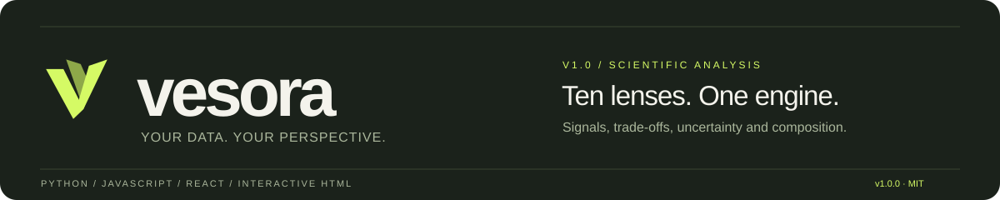
</p>

<p align="center">
  <strong>Find the event. Inspect the sample. Share the observation.</strong><br />
  Scientific visualization for Python, JavaScript and React.<br />
  <sub>WebGL2 · MIT · Zero runtime npm dependencies in the core</sub>
</p>

<p align="center">
  <a href="#ten-charts-ten-questions">Explore the charts</a> ·
  <a href="#try-the-guided-tour">Run the tour</a> ·
  <a href="#start-with-your-language">Quickstart</a> ·
  <a href="#three-complete-analysis-workflows">Workflows</a> ·
  <a href="docs/v1.md">Documentation</a>
</p>

<p align="center">
  <a href="https://discord.gg/5yjk9Bb5N">Join the Discord community</a> ·
  <a href="https://x.com/UEdizaslan">Follow @UEdizaslan on X</a>
</p>

[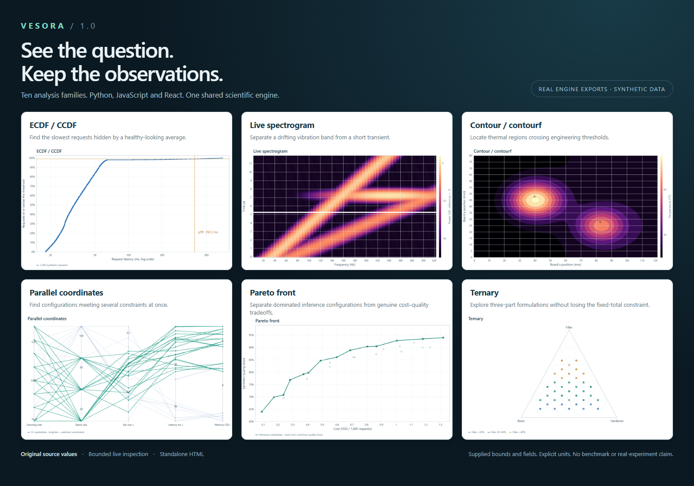](docs/assets/v1/hero.png)

Vesora connects a live measurement to the data behind the view. Freeze an interesting event while acquisition continues, inspect original samples across linked panels, and share an interactive HTML file containing the observation and its source values. Python notebooks, Qt desktop windows, browser applications and React use the same TypeScript/WebGL2 engine.

**Version 1.0 adds ten analysis families** for the questions a line chart leaves open: how heavy is the tail, when did the spectrum change, which alternatives survive a trade-off, and does the response depend on the path taken?

## Ten charts, ten questions

Every image below is an actual Vesora export from a deterministic synthetic example. Click an image to inspect it at full resolution. The [guided tour](examples/web/v1-tour.html) explains the same examples interactively; [Türkçe grafik rehberi](docs/chart-guide.tr.md) explains when to use each one.

<table>
  <tr>
    <td width="50%" valign="top">
      <h3>01 · ECDF / CCDF</h3>
      <a href="docs/assets/v1/ecdf.png">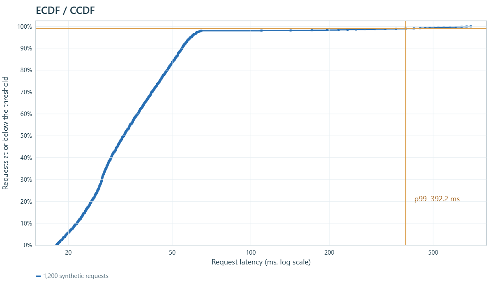</a>
      <p><strong>How many requests meet the deadline?</strong><br />Find slow requests hidden by a healthy-looking average. Read the fraction at or below a threshold, then inspect the remaining tail and nearest-rank percentiles.</p>
      <p><code>ecdf</code> · <code>ccdf</code> · <code>queryECDF</code></p>
    </td>
    <td width="50%" valign="top">
      <h3>02 · Live spectrogram</h3>
      <a href="docs/assets/v1/spectrogram.png">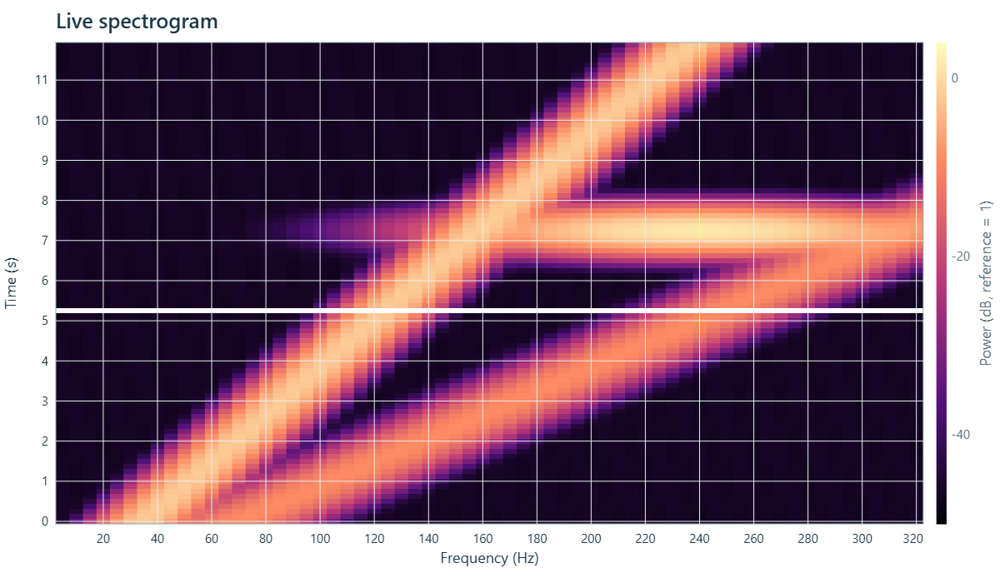</a>
      <p><strong>When did the frequency content change?</strong><br />Inspect supplied vibration, acoustic or instrument spectra. Follow a moving band or a brief burst while appended rows retain a bounded time window.</p>
      <p><code>spectrogram</code> · <code>appendRows</code></p>
    </td>
  </tr>
  <tr>
    <td width="50%" valign="top">
      <h3>03 · Event timeline</h3>
      <a href="docs/assets/v1/timeline.png">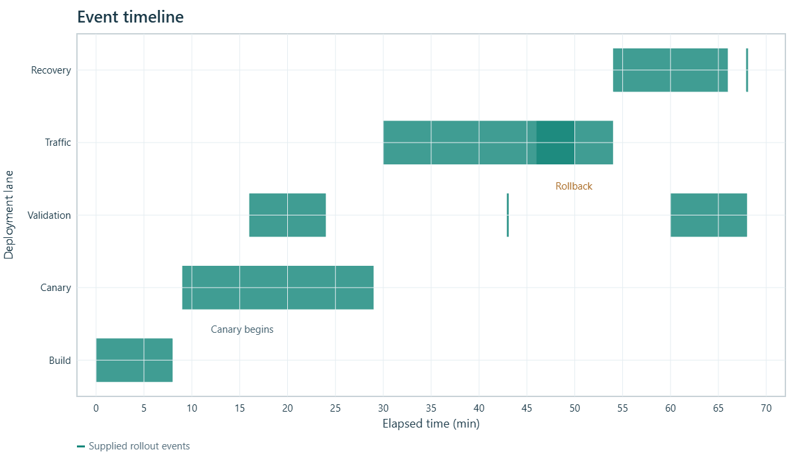</a>
      <p><strong>What was happening around the anomaly?</strong><br />Place a canary rollout, validation and recovery log on one time axis. Compare overlapping work, interruptions and checkpoints with the signal you are investigating.</p>
      <p><code>eventTimeline</code></p>
    </td>
    <td width="50%" valign="top">
      <h3>04 · Asymmetric error bars</h3>
      <a href="docs/assets/v1/errorbar.png">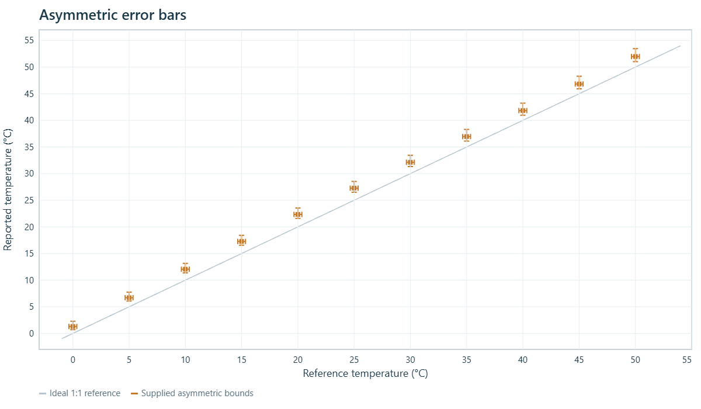</a>
      <p><strong>How much of the difference survives the bounds?</strong><br />Compare calibration points, repeated measurements or supplied uncertainty intervals. Inspect the nominal value and its actual lower and upper endpoints together.</p>
      <p><code>errorbar</code></p>
    </td>
  </tr>
  <tr>
    <td width="50%" valign="top">
      <h3>05 · Contour / filled contour</h3>
      <a href="docs/assets/v1/contour.png">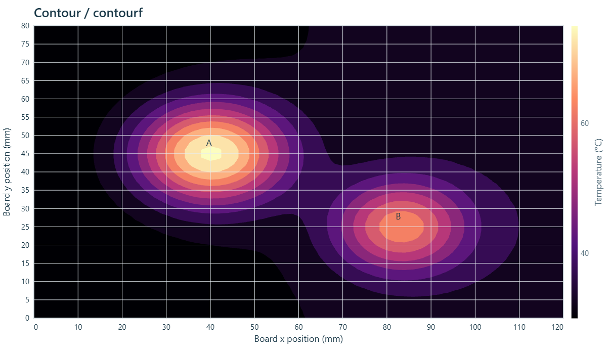</a>
      <p><strong>Where are the hot spots and narrow operating regions?</strong><br />Explore sampled temperature, pressure or objective grids. Equal-value lines make ridges, basins and gradients easier to follow; filled bands reveal regions between levels.</p>
      <p><code>contour</code> · <code>contourf</code></p>
    </td>
    <td width="50%" valign="top">
      <h3>06 · Quiver</h3>
      <a href="docs/assets/v1/quiver.png">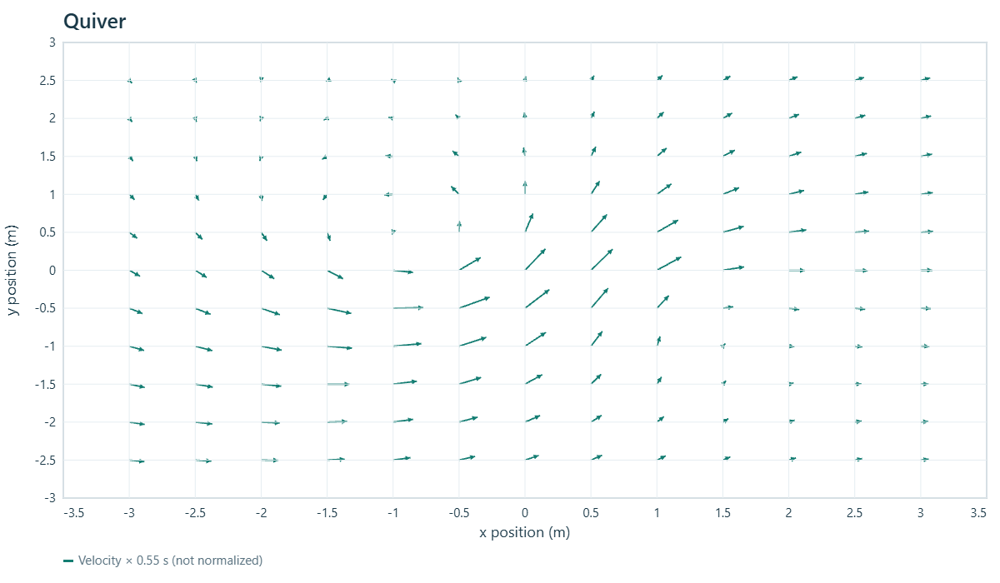</a>
      <p><strong>Which way does the field move?</strong><br />Inspect supplied flow, force or gradient vectors. Arrow direction exposes local changes; explicit scaling and optional normalization control how magnitude is represented.</p>
      <p><code>quiver</code></p>
    </td>
  </tr>
  <tr>
    <td width="50%" valign="top">
      <h3>07 · Parallel coordinates</h3>
      <a href="docs/assets/v1/parallel.png">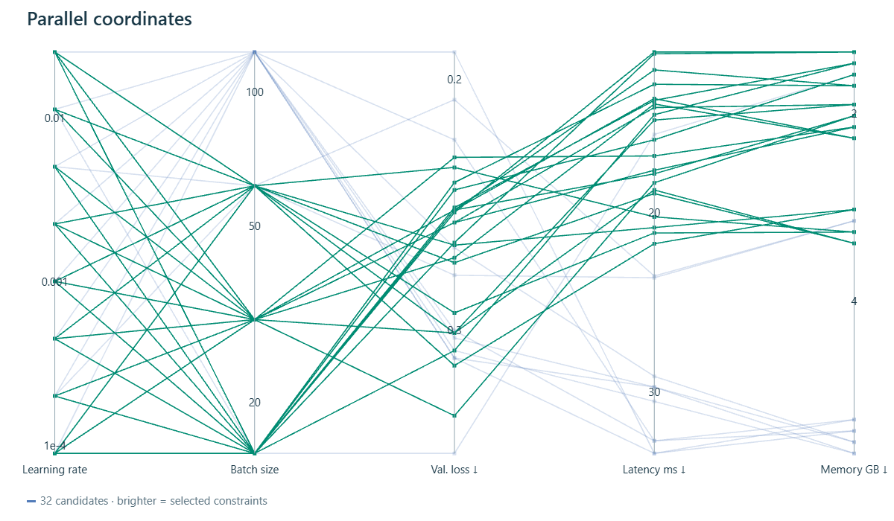</a>
      <p><strong>Which candidates satisfy several constraints?</strong><br />Compare training configurations across learning rate, batch size, loss, latency and memory. Brush dimensions in their original units and follow the same candidate IDs across views.</p>
      <p><code>parallelCoordinates</code></p>
    </td>
    <td width="50%" valign="top">
      <h3>08 · Pareto frontier</h3>
      <a href="docs/assets/v1/pareto.png">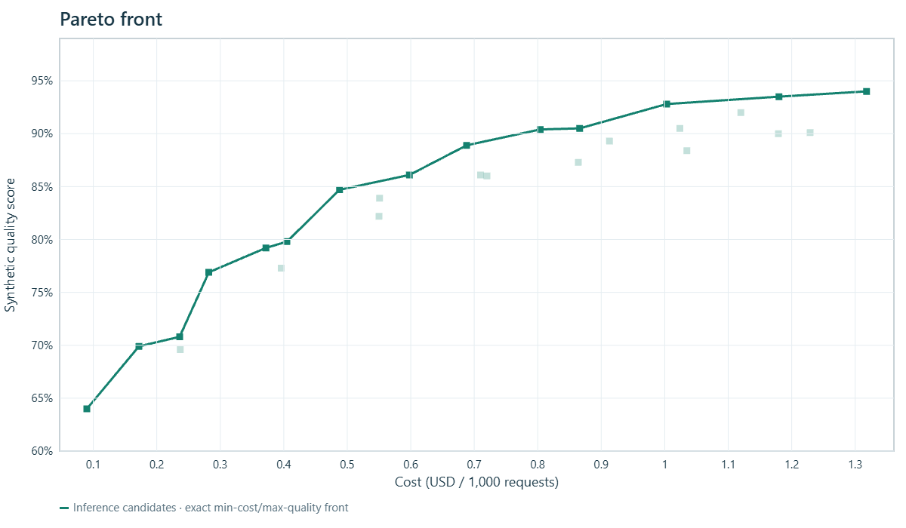</a>
      <p><strong>Which alternatives remain worth considering?</strong><br />Compare inference cost against quality with explicit min/max objectives. Frontier points survive because no other candidate is at least as good on both objectives and better on one.</p>
      <p><code>paretoFront</code></p>
    </td>
  </tr>
  <tr>
    <td width="50%" valign="top">
      <h3>09 · Phase portrait / hysteresis</h3>
      <a href="docs/assets/v1/hysteresis.png">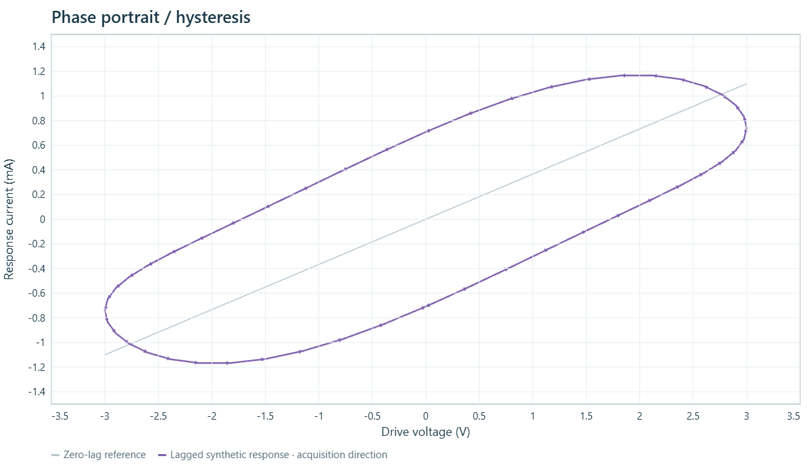</a>
      <p><strong>Does the response depend on how you got here?</strong><br />Inspect loading/unloading sweeps, control response or paired state variables. Acquisition order and direction preserve loops and distinct responses at the same input.</p>
      <p><code>phasePortrait</code> · <code>hysteresis</code></p>
    </td>
    <td width="50%" valign="top">
      <h3>10 · Ternary composition</h3>
      <a href="docs/assets/v1/ternary.png">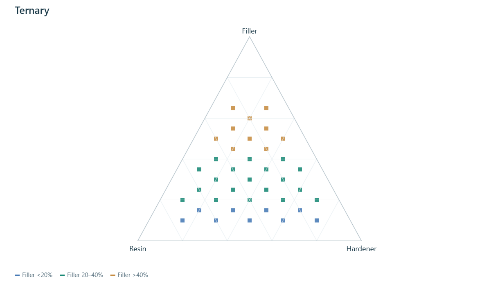</a>
      <p><strong>How does a three-part recipe change?</strong><br />Compare mixtures, material compositions or three-way allocations. Corners represent single components; edges and interior points reveal the balance between all three.</p>
      <p><code>ternary</code></p>
    </td>
  </tr>
</table>

Existing line, interval-band, scatter, heatmap, histogram, bar, boxplot, surface, 3D line and 3D scatter APIs remain available, including mixed 2D/3D panels. [Full analysis API and Python names →](docs/v1.md)

## Try the guided tour

From this checkout, with Node.js **22.12+** and a WebGL2-capable browser:

```sh
npm ci
npm run build
npm run demo:react
```

Open the Vite URL and append **`?demo=tour`**. Choose a chart, read the question it answers, and inspect its samples. Deep links such as `?demo=tour&chart=pareto` open a specific example.

For the plain browser version, run `npm run demo` and open [the standalone tour](http://127.0.0.1:4173/examples/web/v1-tour.html). The [original scientific gallery](http://127.0.0.1:4173/examples/web/v09.html) and [all-ten panel gallery](http://127.0.0.1:4173/examples/web/v1.html) are also available. All demo data is synthetic.

## Three complete analysis workflows

Open the React URL with **`?demo=v1`** to try workflows that connect several views:

| Workspace | A concrete job it helps you finish |
| --- | --- |
| **Signal + events** | Match a waveform change to a spectrum and event window, freeze the displayed observation, and inspect it while acquisition continues. |
| **Run comparison** | Align runs to explicit event offsets, compare matching source values and inspect the difference panel. The comparison helper also returns residuals, ratios and sample lineage. |
| **Cohort exploration** | Select candidates across scatter, ECDF, parallel and Pareto views; follow their stable IDs into a paginated table with complete membership queries. |

**Studio** provides inspection and export controls. **Embed** fits the same viewer into an application-owned card. Both retain the distinction between latest accepted data and the completed displayed frame. [Workflow contracts](skills/vesora/references/workflows.md) · [Runnable workspace source](examples/web/v1-scenarios.js)

## Inspect the sample

The shared viewer command bar holds the view actions, a status pill, and one Export menu. The pill reads Live, Frozen snapshot, or Ready. While frozen, it includes the capture time. Export writes PNG or HTML from the displayed frame or the latest accepted data, with a checkbox for the observation record. The full-width Export options row is gone.

The sample card can take keyboard focus. It shows the layer, coordinates, the unit when one is declared, the source index, and the representation method when available. Revision, byte, and worker details stay in a collapsed Details disclosure. A theme change while frozen updates the chrome immediately and applies the plot theme when the view returns to live.

Line, band, and spectrogram panels that share a linear or time x axis, and a single panel of those kinds, show an x-range strip under the plot. Dragging sets the x domain, and a double-click clears it. When axes share x, the cursor shows each line's nearest recorded sample from x inspection, with no interpolated value. A heatmap or spectrogram cell appears only when the event already includes cell indices. The selection table pages the event's indices, 20 rows at a time. Linked selection is still two scatters and one histogram.

Viridis and magma use the 256 Matplotlib 3.10.7 stops. Coolwarm is available. `colorMap` accepts under, over, and bad colors. Scatter interaction on worker-owned data replans from a spatial grid, and the first query may build that grid. Mutable caller buffers still scan. An unindexed point query records indices during the visibility pass. 3D picking builds its projected index in chunks and keeps a hit only when it passes the existing hit test.

## Start with your language

### Python

```python
import vesora as vs

samples = [12, 14, 14, 28, 90]
fig = vs.figure(title="Request latency")
latency = fig.ecdf(samples, label="Latency")
latency.set_semantics({"samples": {"quantity": "duration", "unit": "ms"}})
fig.set_axes(xlabel="Latency (ms)", ylabel="Fraction at or below")
print(vs.query_ecdf(samples, probability=0.99, threshold=30))
fig.save_html("latency.html", observation=True)
fig.show()  # Jupyter widget or Qt desktop window.

# When you have finished with this figure: fig.close()
```

Python **3.10+**; lists and numeric buffers work directly, and NumPy is optional. The `notebook` extra adds widget support. [Python guide](skills/vesora/references/python.md) · [Executable ten-family example](skills/vesora/scripts/example_python.py)

### JavaScript / TypeScript

Provide `<div id="chart" style="height:420px"></div>` in your page, then use a browser bundler:

```js
import {figure, toHTMLAsync} from '@vesora/core/runtime';
import {mountViewer} from '@vesora/core/viewer';

const fig = figure({title: 'Request latency', height: 420});
fig.ccdf([12, 14, 14, 28, 90], {label: 'Latency tail'});
fig.setView({xLabel: 'Latency (ms)', yLabel: 'Fraction above'});
const viewer = mountViewer(fig, document.getElementById('chart'), {
  mode: 'studio', exportSource: 'displayed', observation: true,
});
await fig.ready();

// Capture from your application's export action.
const html = await toHTMLAsync(fig, {source: 'displayed', observation: true});

// Call when the owning screen is removed.
function dispose() { viewer.dispose(); fig.close(); }
```

The lightweight runtime loads the HTML export template on demand. The compatibility root entry also supplies synchronous `toHTML`. [JavaScript guide](skills/vesora/references/javascript.md) · [Core API](docs/api.md)

### React

`VesoraViewer` hosts every analysis family and borrows the Figure from your application:

```tsx
'use client';
import {useEffect, useState} from 'react';
import {figure, type Figure} from '@vesora/core/runtime';
import {VesoraViewer} from '@vesora/react/viewer';

export function LatencyCard() {
  const [current, setCurrent] = useState<Figure | null>(null);
  useEffect(() => {
    const fig = figure({title: 'Latency distribution', height: 360});
    fig.ecdf([12, 14, 14, 28, 90]);
    setCurrent(fig);
    return () => fig.close();
  }, []);
  return current ? <VesoraViewer figure={current} mode="embed" /> : null;
}
```

For declarative line, bar and scatter cards, use `VesoraChart` with themes, formatting, legends, tooltips and loading states. React **18.3 and 19** are supported peer ranges. [React API](packages/react/README.md) · [Runnable React example](skills/vesora/scripts/example_react.tsx)

## Install Vesora 1.1.0

The release targets `vesora` on PyPI and `@vesora/core` / `@vesora/react` on npm. Use the matching versions together:

```sh
python -m pip install vesora==1.1.0
# For Jupyter notebooks:
python -m pip install "vesora[notebook]==1.1.0"

npm install @vesora/core@1.1.0
# For React applications:
npm install @vesora/core@1.1.0 @vesora/react@1.1.0 react react-dom
```

Check the [GitHub release](https://github.com/U-C4N/Vesora/releases/tag/v1.1.0) for publication status and downloadable archives. Registry publication is a separate step from this source tag. To build local review archives from this checkout:

```sh
npm run build
python -m pip install "setuptools>=77" wheel
npm run package:release -- --candidate
```

The output is `dist/release-v1.1.0/`. These install commands use paths relative to the repository root; another application can point to the same archive files:

```sh
npm install ./dist/release-v1.1.0/vesora-core-1.1.0.tgz ./dist/release-v1.1.0/vesora-react-1.1.0.tgz react react-dom
python -m pip install ./dist/release-v1.1.0/vesora-1.1.0-py3-none-any.whl
```

The Python wheel includes matching renderer and desktop assets. For widgets, install the wheel with its `notebook` extra. [1.1.0 notes](docs/releases/v1.1.0.md) · [1.0.0 notes](docs/releases/v1.0.0.md)

## Keep the data behind the view

A portable observation connects source values, declared units, source versions and the retained stream interval. **Freeze** holds an independent displayed observation while new data can still be accepted. PNG captures the image; self-contained HTML includes the values and matching interactive runtime.

| Capture | What you share |
| --- | --- |
| `accepted` | The latest accepted scene and retained values; the representation is explicitly unevaluated. |
| `displayed` | The last completed frame and its matching values, including a frozen inspection. |

Offline HTML opens without Python or an asset server. It contains the retained snapshot; producers, application callbacks and evicted history remain outside it. [Observation guide](docs/observation.md) · [Streaming guide](docs/streaming.md)

## Measured, with the workload attached

The recorded local **`verify:next` run passed in 45.528 seconds**, including build, packaging, browser/offline checks and the exact wheel's real Qt/Jupyter workflows. Dependency installation is outside that duration. Repeat the bounded automatic check with:

```sh
npm run verify:next
```

It has one 600-second wall-clock budget, fails missing required hosts or timeouts, and writes its reports to `artifacts/v1-verification/`. [Recorded verification and scope](docs/verification-v1.md)

Short fixed Windows Chromium/WebGL2 probes with configured ANGLE recorded:

| Workload | Recorded result |
| --- | ---: |
| 500,000-point 3D scatter, first cold pick | **25.5 ms** |
| Same size, cold pick after camera rotation | **24.4 ms** |
| Three retained 100,000-row lines; 32 atomic batches of 100 rows | **16.2 ms p95 / 31.0 ms p99** append-to-completed-frame |

These are the 1.0.0 short local workloads, with frame completion distinct from physical display time. [Conditions, archive identity and results](docs/releases/v1.0.0.md) accompany those measurements; long-duration endurance and human accessibility evaluation are separate evidence.

On 17 November 2026, one machine (Intel Core Ultra 9 275HX, Chrome 157 headless, ANGLE Intel Graphics, 1000×700) remeasured a 1,000,000-point scatter. Interaction p95 went from 317.4 ms to 75.5 ms. First render went from 215.8 ms to 460.5 ms because the spatial grid is built on the first query. Other panel cases on that machine were mixed. A separate SwiftShader streaming run is not a hardware frame rate. This is not a claim that the product is faster overall. [1.1.0 notes](docs/releases/v1.1.0.md)

## Use Vesora with an agent

The portable [Vesora skill](skills/vesora/SKILL.md) includes Python, JavaScript and React instructions, executable examples, and lifecycle, streaming and export contracts. An agent with repository access can read it directly, or you can copy `skills/vesora` into your agent's skill directory. [llms.txt](llms.txt) is the compact documentation entry point.

## Scientific scope

Spectrograms display **supplied time × frequency values** with a regular time cadence; FFT preparation belongs to your analysis pipeline. Error bars display supplied bounds. Contours interpolate a regular scalar grid, Pareto compares two explicit objectives, and ternary normalization is opt-in. Units and external transform descriptions are declarations; they do not execute conversions or certify numerical accuracy.

Generic streaming covers numeric 2D line/scatter, with a separate bounded-row spectrogram API. Parallel and ternary views occupy dedicated 2D projection panels. SVG/PDF export, WebGPU, arbitrary mesh/volume rendering and a persistent full-history recorder remain outside this implementation.

## Find the details

[Analysis API](docs/v1.md) · [Core API](docs/api.md) · [React API](packages/react/README.md) · [Architecture](docs/architecture.md) · [Image provenance](docs/assets/README.md) · [Release notes](docs/releases/v1.1.0.md) · [MIT license](LICENSE)
