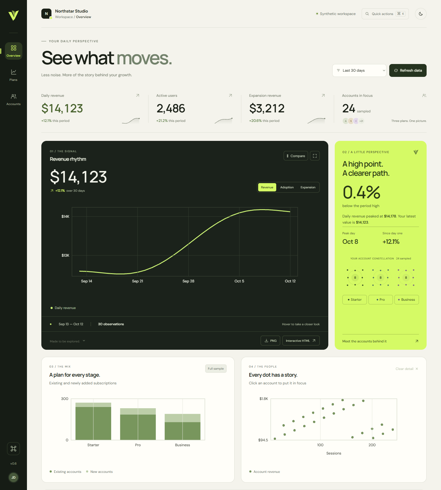
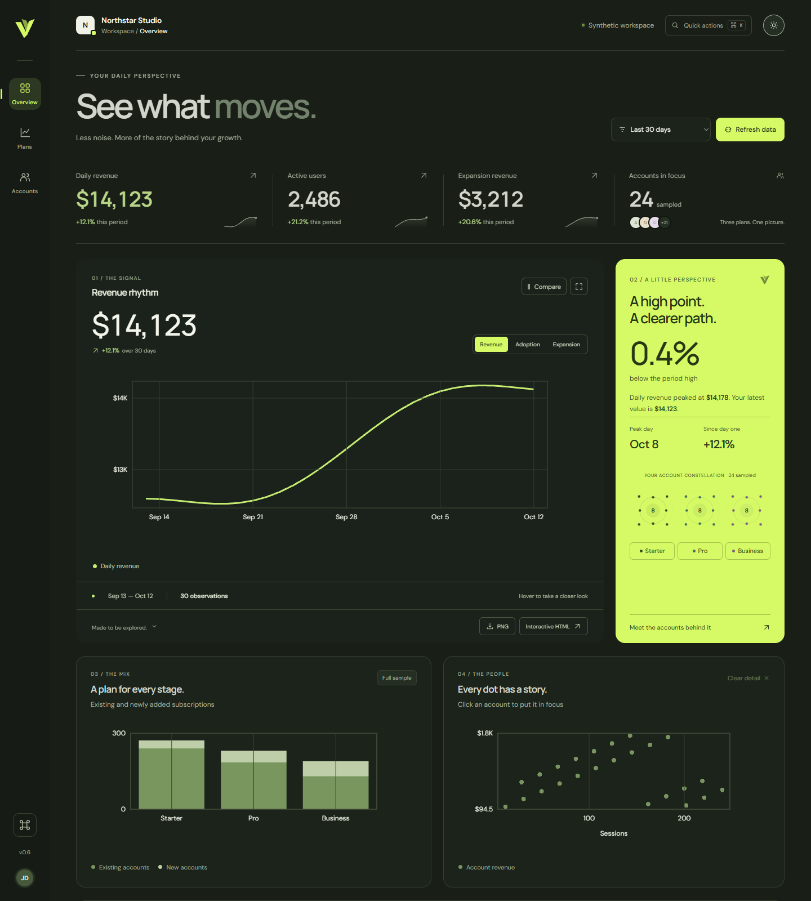
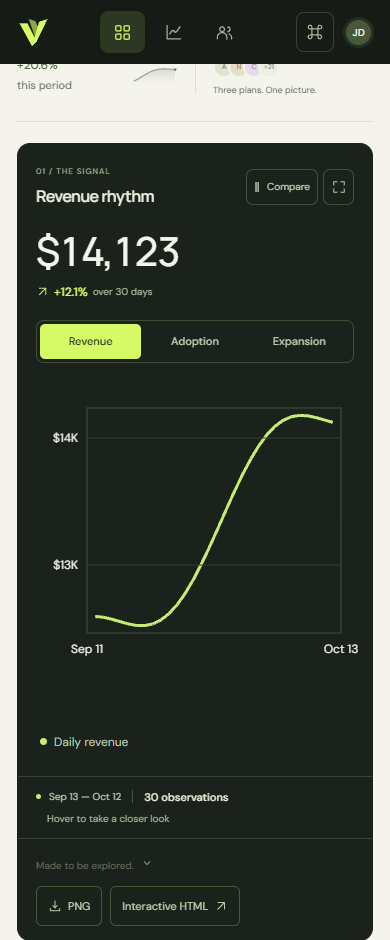
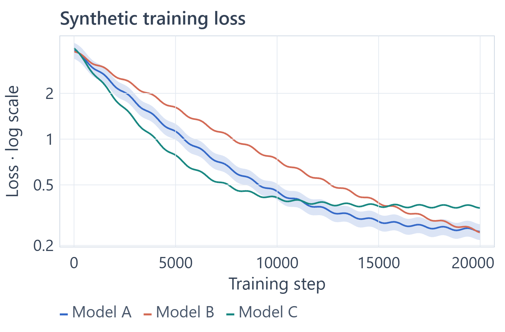
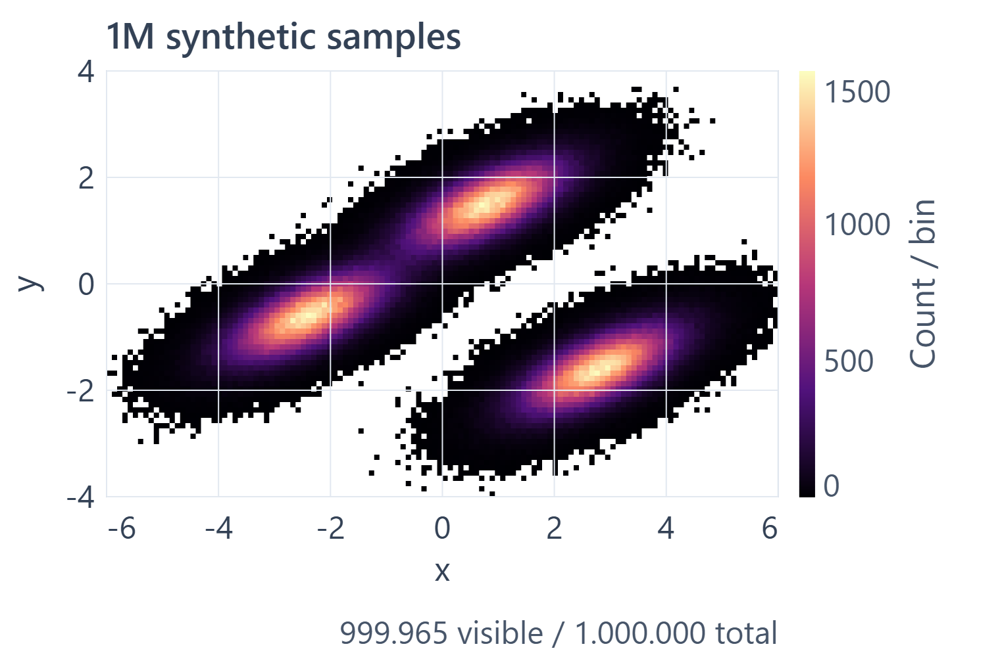
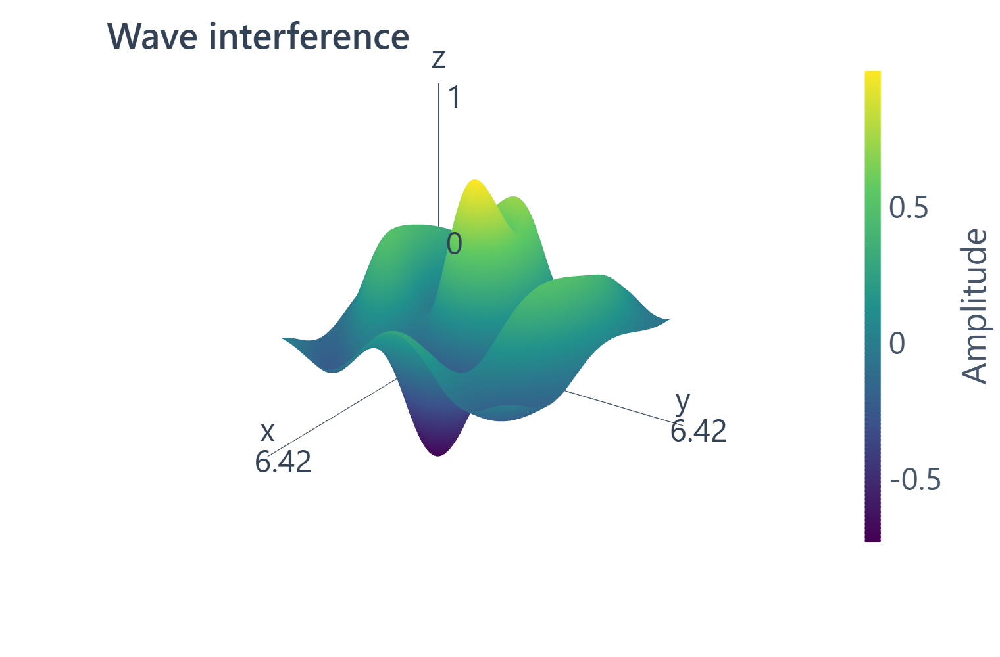
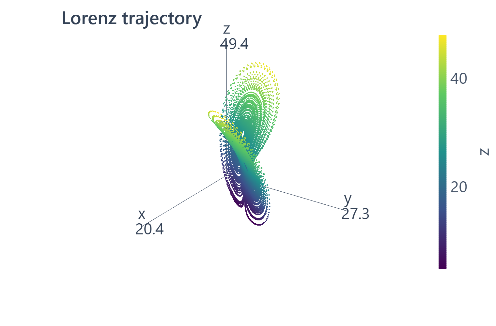

<p align="center">
  
</p>

<p align="center">
  <strong>Charts that fit your app. One engine for React, JavaScript and Python.</strong><br>
  React + TypeScript · Custom themes · Interactive exploration · PNG &amp; offline HTML
</p>

<p align="center">
  <a href="#signal-studio">Signal Studio</a> ·
  <a href="#react-saas-charts-in-v06">React</a> ·
  <a href="#see-it-in-action">Scientific gallery</a> ·
  <a href="#get-started">Quick start</a> ·
  <a href="docs/api.md">API reference</a> ·
  <a href="docs/releases/v0.9.0.md">PRISM candidate</a>
</p>

> **v0.9.0-rc.4 PRISM candidate, MIT licensed.** Build and install the local archives below. This checkout is not a completed public release; the [release gates](docs/releases/v0.9.0.md) track remaining validation. WebGL2 is required; Python desktop windows use QtWebEngine.

## PRISM: scientific inspection and live telemetry

Explore a surface alongside exact row/column profiles, color it by a separate scalar, and inspect continuous 3D trajectories. The optional Obsidian viewer shares camera controls, source identities and displayed-frame exports across JavaScript, React, Python hosts and offline HTML. Freeze inspection while bounded live ingestion continues; return to live when ready.

Start with the [PRISM API and migration guide](docs/prism.md), [three interactive reference demos](examples/web/v09.html), [measured evidence](docs/benchmarks/v0.9.0.md), or [five-participant pilot packet](docs/pilot/v0.9.0/README.md). Existing `VesoraChart` defaults remain available. Experimental bounded 3D streams and A/B pins require the separate `@vesora/core/labs` entry; automatic adaptive detail is not included.

## New in v0.8: bounded live measurements

Append numeric line/scatter data with an explicit retained capacity in Python, JavaScript and React. The shared engine keeps accepted updates atomic, identifies samples across evictions, and captures a frozen retained snapshot for PNG or offline HTML. Worker watchdogs, WebGL restoration and resource diagnostics make long-running charts easier to operate.

```python
import vesora as vs

fig = vs.figure(title="Live measurements")
line = fig.plot([], [], label="Signal").enable_streaming(max_points=100_000)
line.append_data(x=[0, 1, 2], y=[3.2, 1.8, 1.0])
fig.show()
```

Read the [streaming guide](docs/streaming.md), [v0.8 release notes](docs/releases/v0.8.0.md) and [recorded measurements](docs/benchmarks/v0.8.0.md). Run the three-curve examples in [JavaScript](examples/web/streaming.html), [Python](examples/python_streaming.py), or the [React starter](examples/react-saas/README.md). Existing scene protocols 1–6 remain supported.

## New in v0.7: readable figures and shared inspection

Draw an explicit interval around a curve, compare source samples at a common cursor x position, and export at a chosen size. Themes now separate title, axis-label, tick and legend sizes; colorbars can name the quantity and units they encode. The same scene works in Python, JavaScript, React and offline HTML.

```python
import vesora as vs

x, mean = [0, 1, 2, 3], [3.2, 1.8, 1.0, 0.7]
fig = vs.figure(title="Synthetic learning curve", theme={"tickFontSize": 14, "labelFontSize": 16})
fig.fill_between(x, [v * .85 for v in mean], [v * 1.15 for v in mean], color="#3569c8")
fig.plot(x, mean, color="#3569c8", label="Model A")
fig.set_axes(xlabel="Training step", ylabel="Loss", yscale="log")
fig.set_hover_mode("x")
fig.savefig("learning.png", width=1000, height=600, scale=2)
```

The example bounds are synthetic and illustrative; Vesora does not estimate a confidence interval. Shared-x inspection reports actual source samples without interpolation. Read the [v0.7 overview](docs/releases/v0.7.0.md), [interval and inspection API](docs/api.md#show-an-interval-around-a-curve) and [React band API](packages/react/README.md#show-bands-and-compare-series).

<p align="center">
  <a href="docs/assets/signal-studio-light.png"></a>
</p>

## Signal Studio

**See what moves.** The [React SaaS starter](examples/react-saas/) pairs a dark chart stage with warm paper surfaces, a compact navigation rail and a responsive account workspace. The charts use Vesora's own engine; the surrounding cards, filters and table are ordinary React components you can adapt to your product.

| After dark | On a small screen |
| :---: | :---: |
| <a href="docs/assets/signal-studio-dark.png"></a> | <a href="docs/assets/signal-studio-mobile.png"></a> |
| Coordinated chart, text and interface colors. | The same working dashboard at 390 px. |

- Switch between **Revenue, Adoption and Expansion**, choose a 7/30/90-day window, and compare an available preceding period on the same date axis.
- Inspect an account from the scatter plot or table; search, filter by plan and page through the results. The account constellation also works as a plan filter.
- Open quick actions with **Ctrl/Cmd + K**, refresh the simulated API, switch themes, or export the current chart as PNG or interactive HTML.

The screenshots show deterministic **synthetic data**, not customer results. The account workspace contains 24 sampled rows; the subscription chart uses a separate, larger synthetic plan summary. Metrics and insights are computed from the selected data. See the [starter guide](examples/react-saas/README.md) for controls, data replacement and export behavior.

## React SaaS charts in v0.6

Use `@vesora/react` for declarative line, grouped/stacked bar and scatter charts. The component owns rendering and cleanup, retains series identity during data refresh, and supplies keyboard-operable legends, custom tooltips and loading/empty/error states. The framework-independent core remains available.

```tsx
import { VesoraChart } from '@vesora/react';

const rows = [
  { timestamp: Date.UTC(2026, 9, 1), revenue: 4200, cost: 2100 },
  { timestamp: Date.UTC(2026, 9, 2), revenue: 5100, cost: 2300 },
];

export function RevenueChart() {
  return <VesoraChart type="line" data={rows} xKey="timestamp"
    series={[{ key: 'revenue', label: 'Revenue' }, { key: 'cost', label: 'Cost' }]}
    theme="dark" height={360} xAxis={{ type: 'time' }}
    yAxis={{ format: 'currency', currency: 'USD' }} />;
}
```

From this checkout:

```bash
npm ci --cache artifacts/npm-cache
npm run build
npm run demo:react
```

Open the URL printed by Vite to run Signal Studio. See the [React API](packages/react/README.md), [shared presentation API](docs/api.md#themes-dates-and-number-formats) and [web developer pilot](docs/pilot-v0.6.md).

Build portable packages with `npm run package:release`, then install the matching archives into another React project:

```bash
npm install ./vesora-core-0.9.0-rc.4.tgz ./vesora-react-0.9.0-rc.4.tgz
```

React 18.3/19 is a peer dependency. The core has no runtime npm dependencies. HTML export explicitly includes all chart source rows and excludes React callbacks; use the ref handle's `exportPNG`, `exportHTML` and `resetView` methods. The pilot thresholds are proposed validation criteria, not completed user research or measured competitive advantages.

## See it in action

These are **real PNG exports from Vesora's shared engine**, generated through the Python API without NumPy. Click a figure to inspect it at full resolution.

### Compare learning curves

<a href="docs/assets/training-loss.png"></a>

Multi-series lines, log scales, readable labels and an explicit interval. **Synthetic models and illustrative bounds; not measured confidence intervals or benchmark results.**

### Explore dense measurements

<a href="docs/assets/density.png"></a>

1,000,000 generated samples aggregated into screen-space bins. Color means **count per bin**.

### Inspect mathematical surfaces

<a href="docs/assets/surface.png"></a>

A 140 × 140 regular grid, with color mapped to amplitude.

### Follow nonlinear dynamics

<a href="docs/assets/lorenz.png"></a>

19,000 numerical trajectory samples, with color mapped to z. The PNGs are 1520 × 1000 pixels; their typography is sized for the preview as well as the full image.

The [original gallery](examples/web/) contains **16 experiments: 11 in 2D and 5 in 3D**. The [comparison gallery](examples/web/compare.html) adds **3 multi-panel experiments**, the [statistics gallery](examples/web/statistics.html) adds **6**, and [linked inspection](examples/web/linked.html) adds **one 200,000-row experiment**, bringing the total to 26. Pages remain separate to limit simultaneous GPU contexts. Every experiment includes Python and JavaScript code, PNG export and interactive HTML export.

## New in v0.5: follow the same observations

Select a rectangle in either of two linked scatter plots to highlight the same source rows and compare their count histogram with the full dataset. Membership uses original coordinates even when a scatter is displayed as density. Share the completed cohort in an offline HTML file.

```python
import vesora as vs

fig = vs.subplots(1, 3, title="Inspect model errors", width=1200)
prediction, residual, feature = [1, 2, 3, 4], [0.1, 0.2, 3.0, 0.1], [0.1, 0.2, 0.9, 0.3]
a = fig.panel(0, 0).scatter(prediction, residual)
b = fig.panel(0, 1).scatter(feature, residual)
h = fig.panel(0, 2).hist(residual, bins=[0, 1, 2, 4])
link = fig.link_selection(scatter=[a, b], histogram=h)
fig.show()  # Shift + drag in either scatter plot.
fig.save_html("model-errors.html")
```

Exactly two numeric scatter layers and one count histogram must occupy three distinct 2D panels. Row position identifies an observation: provide equally sized, explicitly aligned arrays. Linked data and histogram options remain fixed until `link.remove()`. Pan/zoom and Reset view preserve the cohort; `link.clear()` and the viewer's Clear selection button remove it. See [linked inspection](docs/api.md#follow-observations-across-views), [the v0.5 release](docs/releases/v0.5.0.md) and [the pilot protocol](docs/pilot-v0.5.md).

## Statistics and categories from v0.4

Create histograms, grouped/stacked bars and boxplots directly from source arrays. Use named categories in bars, boxes, lines and scatter plots. Exact counts and quartiles are computed in the shared TypeScript engine, including when the figure originates in Python or is opened from an offline HTML file. NumPy remains optional.

```python
import vesora as vs

fig = vs.subplots(1, 2, title="Compare measurements", width=1100)
fig.panel(0, 0).hist([1, 2, 2, 3, 3, 3, 4, 8], bins=8)
fig.panel(0, 1).boxplot([[1, 2, 3, 4, 8], [2, 3, 3, 4]],
                        labels=["Batch A", "Batch B"])
fig.bookmark("Overview")
fig.save_html("statistics.html")
```

Try all six [statistics examples](examples/web/statistics.html), or read [the statistical API](docs/api.md#analyze-distributions-and-categories). Histogram bins do not change when zooming. Grouped bars retain slots for missing categories; stacked bars accumulate positive and negative values independently. Histograms and boxplots use linear axes; v0.6 also permits time-positioned bars with a linear value axis.

## Also included: compare and explain

Compare measurements in a fixed 2D grid, pan or zoom shared axes together, and explain the result with data-coordinate text and reference lines. One figure owns the complete layout, one WebGL context, and its exports. Existing single-panel and 3D APIs remain available.

```python
import math
import vesora as vs

x = [i / 100 for i in range(1000)]
signal = [math.sin(t) for t in x]
residual = [0.08 * math.sin(17 * t) for t in x]
fig = vs.subplots(2, 1, sharex=True, title="Signal and residual", height=800)
top, bottom = fig.panel(0, 0), fig.panel(1, 0)
top.plot(x, signal, label="Signal")
top.set_title("Measured signal")
bottom.plot(x, residual, label="Residual")
bottom.axhline(0, color="#64748b")
bottom.text(2, 0.06, "Small oscillation", font_size=13)
bottom.set_axes(xlabel="Time (s)", ylabel="Residual")
fig.bookmark("Overview")
bottom.set_axes(xlim=(2, 3))
fig.bookmark("Detail", note="Both panels show the same interval.")
fig.restore_bookmark("Overview")
fig.save_html("comparison.html")
```

`subplots` returns a `Figure`; `panel(row, col)` uses zero-based indices. Shared axes synchronize scales and limits; panel labels remain independent. A figure bookmark now captures every panel view. Text, `axhline` and `axvline` return handles with `update` and `remove` methods. See the [panel and annotation API](docs/api.md#compare-data-in-panels).

Send the whole layout as **one self-contained HTML file**. No window needs to open to create it. The file embeds original source data and a matching runtime, with bookmarks, reset, PNG download and a layer inspector. In JavaScript, use `toHTML(fig)` or `downloadHTML(fig, "comparison.html")`. Python callbacks, gallery sliders and live connections are not serialized. See [the sharing API](docs/api.md#share-an-interactive-figure).

Run it locally from a checkout:

```bash
npm ci
npm run build
npm run demo
```

Open **[localhost:4173/examples/web/](http://127.0.0.1:4173/examples/web/)**. Node.js 22.12+ is needed for development. The images above are static previews; the local gallery is interactive. Regenerate the images with [`scripts/render_readme.py`](scripts/render_readme.py).

## Why Vesora exists

A scientific workflow can begin in a Python script, move into a notebook and end up in a browser application. Rebuilding the chart for each environment means repeating scale logic, interactions, selection behavior and export code. As data grows, plotting every sample can also obscure the structure you are trying to find.

Vesora brings those workflows onto **one TypeScript engine with two language APIs**. Python prepares data and sends a versioned scene plus binary buffers; JavaScript uses the engine directly. Rendering, scales, cameras, selection and representation planning live in the shared core.

| The problem | Vesora's approach |
| --- | --- |
| A Python chart and its web counterpart drift apart | Shared scene semantics and rendering, with Python/JS parity checks. |
| Dense point clouds hide useful structure | Automatic count aggregation for dense views; individual points when the view is sparse. |
| Reducing a long signal can erase a narrow peak | View-dependent line reduction retains local extrema, ordering and missing-data gaps. |
| Scientific values lose small differences at large offsets | Float64 source coordinates stay separate from normalized GPU coordinates. |
| Users cannot tell what a reduced view represents | JavaScript `fig.inspect()` and representation events report counts, method and exactness; exported files include an inspector. |

Python functions run in Python, and JavaScript functions run in JavaScript. Supply their sampled arrays or grids to Vesora; the engine does not translate arbitrary functions between languages.

## Get started

Build local v0.9 candidate packages from this checkout with Node.js 22.12+ and Python 3.10+:

```bash
python -m pip install "setuptools>=77" wheel
npm ci
npm run build
npm run package:release -- --candidate
```

The result is `dist/release-v0.9.0-rc.4`: a Python wheel, core and React npm tarballs, ten standalone demos, a provenance manifest and `SHA256SUMS.txt`. `--candidate` permits local review builds; publication requires a clean matching tag and passed gates. Packaging does not publish a release. The previously published [v0.2.0 release](https://github.com/U-C4N/Vesora/releases/tag/v0.2.0) remains available for its original feature set.

### Python: a plot in a few lines

With Python 3.10+, install the wheel you built:

```bash
python -m pip install ./dist/release-v0.9.0-rc.4/vesora-0.9.0rc4-py3-none-any.whl
```

```python
import math
import vesora as vs

x = [i / 100 for i in range(1200)]
vs.plot(x, [math.sin(t) for t in x], label="sin(x)")
vs.show()
```

`show()` opens a desktop window and keeps a normal script running until it closes. The wheel includes the compiled engine: **no Node.js setup and no mandatory NumPy dependency**. The desktop installation includes `PySide6` and `aiohttp`.

Use a figure explicitly for multiple layers, updates or export:

```python
fig = vs.figure(title="Two views of a signal")
fig.plot(x, [math.sin(t) for t in x], label="sin(x)", color="#3569c8")
fig.plot(x, [math.cos(t) for t in x], label="cos(x)", color="#d36a55")
fig.set_axes(xlabel="Time (s)", ylabel="Amplitude")
fig.savefig("signal.png")
fig.show()
```

Lists, tuples, `array.array` and supported numeric buffers work out of the box. Existing NumPy arrays also work when NumPy is installed. For notebook support, install the same wheel with the optional extra:

```bash
python -m pip install "./dist/release-v0.9.0-rc.4/vesora-0.9.0rc4-py3-none-any.whl[notebook]"
```

### JavaScript / TypeScript: the same engine in your app

Copy the built tarball into your frontend project and install it:

```bash
npm install ./vesora-core-0.9.0-rc.4.tgz
```

Add a mount element to your HTML:

```html
<div id="chart"></div>
```

Then use the package from a browser frontend entry point with an ESM-capable bundler:

```typescript
import { figure } from "@vesora/core";

const chart = document.getElementById("chart");
if (!chart) throw new Error("Missing #chart element");

const x = Float64Array.from({ length: 1200 }, (_, i) => i / 100);
const fig = figure({ title: "Two views of a signal" });
fig.plot(x, x.map(Math.sin), { label: "sin(x)", color: "#3569c8" });
fig.plot(x, x.map(Math.cos), { label: "cos(x)", color: "#d36a55" });
fig.setView({ xLabel: "Time (s)", yLabel: "Amplitude" });
fig.mount(chart);
```

The core package includes TypeScript declarations and has **no runtime npm dependencies**. It needs browser APIs and WebGL2 to render. The package's `dist/index.js` can also be imported directly from an HTTP-served page; keep `dist/worker.js` alongside it. See the [API reference](docs/api.md) for updates, events, PNG downloads and cleanup.

## How it compares with Matplotlib

**The key difference is the shared Python/browser architecture.** Vesora is a young engine for interactive scientific exploration across both ecosystems. Matplotlib provides a much broader plotting system and export ecosystem today.

| Dimension | Vesora today | Matplotlib today |
| --- | --- | --- |
| Programming model | Python and JS/TS APIs feed the same TypeScript engine. | Python plotting APIs with pluggable output backends. |
| Rendering | WebGL2 data drawing; Canvas2D text and annotations. | Multiple raster, vector and interactive backends. |
| Interaction | Pan/zoom, shared 2D axes, hover and region selection, 3D orbit in the shared viewer. | Interactive figures, navigation tools and an event system. |
| Dense data | Automatic scatter count aggregation, extrema-preserving line reduction and representation inspection. | Line simplification, marker subsampling and Agg path chunking are available. |
| 3D | Regular-grid surfaces, scalar colors, 3D scatter/trajectories, mixed panels and exact row/column slices. | `mplot3d` supports a wider range of 3D plot types. |
| Export | PNG, including axes and labels; self-contained interactive HTML with bookmarks. | PNG, SVG, PDF and other formats, depending on backend. |
| Maturity | v0.9 PRISM candidate; scientific inspection, bounded streaming and shared viewer, with explicit outstanding release gates. | An established plotting library with extensive configuration and documentation. |

Choose Vesora when sharing one engine between Python and a browser application is central to your workflow. Prefer Matplotlib today when you need its broader plotting catalog, publication layout controls or vector export. Vesora does not implement the Matplotlib API, and this project makes **no unmeasured speedup claim** against it.

Comparison references: Matplotlib's official [backend documentation](https://matplotlib.org/stable/users/explain/figure/backends.html), [interactive figures](https://matplotlib.org/stable/users/explain/figure/interactive.html), [performance options](https://matplotlib.org/stable/users/explain/artists/performance.html) and [`mplot3d` reference](https://matplotlib.org/stable/api/toolkits/mplot3d.html).

## Inside the engine

```text
Python API                            JavaScript / TypeScript API
    │                                             │
    └── desktop / notebook host + binary bridge ───┤
                                                  ▼
                                    Shared TypeScript engine
                                scene · scales · camera · selection
                                                  │
                                  Viewport / representation planner
                                    worker queries · bounded cache
                                                  │
                                   WebGL2 data + Canvas2D labels
                                                  │
                                     Interactive view / PNG export
```

The Python adapter manages the local viewer connection. Numeric buffers retain their dtype, shape and version. Query cancellation prevents late results from an older view replacing a newer one. Layer updates reuse the figure; `close()` releases its viewer resources. Read the [architecture guide](docs/architecture.md) for the contracts and limits.

## What works, and what comes next

| Available in the preview | Planned extensions |
| --- | --- |
| `plot`, `fill_between`, `scatter`, `heatmap`, `surface`, `scatter3d`, `hist`, `bar`/`barh`, `boxplot` | Violin plots, vector fields and adaptive function sampling |
| Fixed 2D grids, shared axes, source-sample x inspection, text and reference lines | Error bars and more layout tools |
| Desktop Python, notebook adapter and browser JS/TS | Additional data providers and host integrations |
| In-memory adaptive representations, bounded numeric streaming and cancellable queries | Indexed disk data, tiles and additional streaming plot types |
| Sized PNG export, readable typography, self-contained HTML and view bookmarks | SVG/PDF export and additional render backends |

Scatter and general line queries can scan **O(n)** source rows; sorted numeric lines narrow the visible x interval. Workers copy source buffers and reuse immutable chunks when streaming. The million-sample example demonstrates aggregation; it is not a universal frame-rate guarantee. Cross-dataset joins, indexed out-of-core data, statistical streaming and general mesh/volume rendering remain outside this release. Bounded trajectory and rolling-surface experiments live in the separate Labs entry; automatic adaptive detail is excluded. WebGPU remains a future option to evaluate against measured bottlenecks.

## Develop and validate

From a checkout, using Node.js 22.12+ and Python 3.10+:

```bash
npm ci
npm run build
python -m pip install -e ".[test,notebook]"
npm run check
npm run test:parity
npm run test:examples
npx playwright install chromium
npm run test:browser
npm run test:saas
python -m pytest tests/python
```

The checks cover scene equivalence, real rendered pixels, invalid values and gaps, stale queries, layer updates, panels, annotations, exports and resource cleanup. The galleries' **26 Python snippets run with NumPy blocked**, alongside their 26 JavaScript equivalents. Real Qt desktop tests are opt-in; the browser tests use software WebGL and are not hardware benchmarks. Run `npm run benchmark:panels` for a measured single-panel versus four-panel comparison; see [development and measurement](docs/development.md).

| Read next | What you will find |
| --- | --- |
| [API and examples](docs/api.md) | Plot types, data updates, selection, notebook use and export |
| [Architecture](docs/architecture.md) | Shared scene model, binary protocol and representation rules |
| [Development and benchmarks](docs/development.md) | Packaging, validation, measured performance and support limits |
| [Scientific gallery](examples/web/), [comparisons](examples/web/compare.html), [statistics](examples/web/statistics.html) and [linked views](examples/web/linked.html) | Twenty-six experiments with Python and JS source |
| [Signal Studio](examples/react-saas/README.md) and [React API](packages/react/README.md) | A working SaaS starter and typed chart component |
| [v0.7 overview](docs/releases/v0.7.0.md) | Readability, bands, shared inspection, exports and compatibility |
| [v0.8 overview](docs/releases/v0.8.0.md) and [streaming guide](docs/streaming.md) | Bounded telemetry, runtime recovery, row identity and release validation |

Have a reproducible rendering issue or a scientific workflow Vesora should support? [Open an issue](https://github.com/U-C4N/Vesora/issues) with a small dataset, the expected result and your environment.
