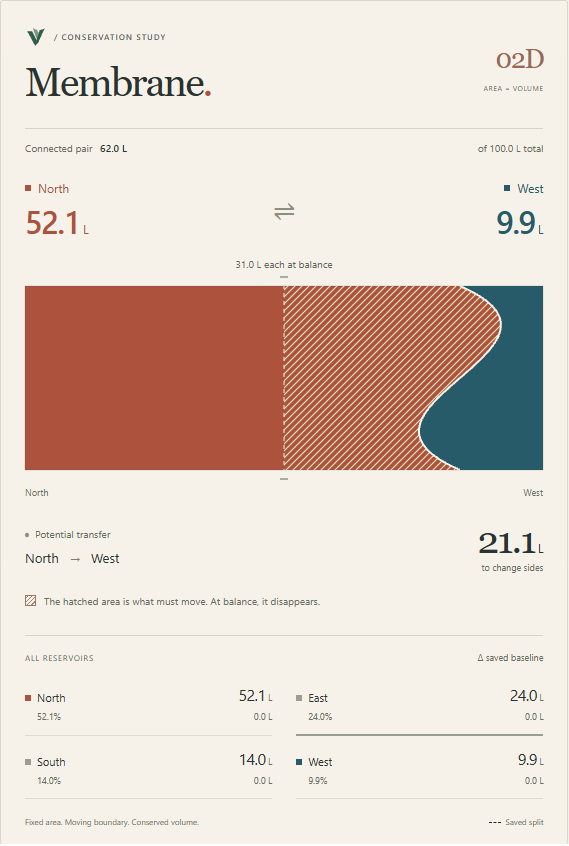
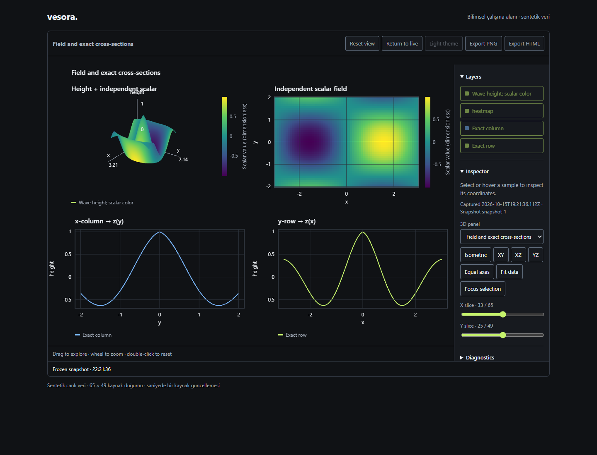

<p align="center">
  
</p>

<p align="center">
  <strong>Scientific visualization for Python, JavaScript and React.</strong><br />
  Explore a surface, inspect a live signal, and share the data behind the view.
</p>

<p align="center">
  <a href="#get-started">Get started</a> ·
  <a href="#denge-membrane">Denge Membrane</a> ·
  <a href="docs/observation.md">Observations</a> ·
  <a href="docs/api.md">API</a> ·
  <a href="docs/releases/v0.9.0-rc.7.md">Release notes</a>
</p>

Vesora brings research figures and application charts into one WebGL2 engine. Python notebooks, Qt desktop windows, browser applications and standalone HTML use the same scene format and renderer. React adds chart components and a viewer you can embed in your own product.

**Current candidate: `0.9.0-rc.7` · Python `0.9.0rc7`.** This is a release candidate prepared for review, not a stable release or a claim of npm/PyPI publication. Final archive acceptance, including uninterrupted endurance, real screen-reader use and the five-person pilot, remains required. See the [candidate status](docs/releases/v0.9.0-rc.7.md).

## What you can build

| Experience | What Vesora provides |
| --- | --- |
| Scientific figures | Mixed 2D/3D panels, surfaces with independent scalar color, exact grid slices, trajectories, linked selection, statistics and annotations. |
| Live inspection | Bounded line/scatter streams, freeze and resume, source-aware picking, and exports of accepted data or the completed displayed frame. |
| Research workspaces | **Studio** exposes layers, inspection, diagnostics and export controls. |
| Embedded charts | **Embed** uses the same viewer in compact containers; React chart cards add themes, formatting, legends, tooltips and loading states. |
| Portable observations | Optional channel units, source descriptions and capture records travel with source values in self-contained HTML. |
| Denge Membrane | An experimental area-based view of conservation and pairwise equalization, linked to a 3D scientific scene. |

The core package has no runtime npm dependencies. NumPy is optional for Python. Use the lightweight browser entry when startup size matters; the standalone HTML template loads on the first async export.

## Get started

### Run the examples

Use Node.js **22.12+** and a WebGL2-capable browser. From this checkout:

```sh
npm ci
npm run build
npm run demo:react
```

Open the Vite URL printed in the terminal:

| URL suffix | Example |
| --- | --- |
| `?demo=balance` | Denge Membrane and its linked 3D view |
| `?demo=workbench` | Studio and an independent 320 px Embed card |
| `?demo=streaming` | Bounded synthetic training telemetry |
| No suffix | Signal Studio, a working SaaS dashboard |

For the scientific gallery, run `npm run demo` and open [the local PRISM gallery](http://127.0.0.1:4173/examples/web/v09.html). All example datasets are synthetic.

### Install the candidate locally

With the candidate assets downloaded or built locally, install the archives into your application or Python environment:

```sh
npm install ./vesora-core-0.9.0-rc.7.tgz ./vesora-react-0.9.0-rc.7.tgz react react-dom
python -m pip install ./vesora-0.9.0rc7-py3-none-any.whl
```

Python requires **3.10+**. The wheel includes the renderer and desktop assets; the `notebook` extra adds the Jupyter widget dependency. React **18.3 and 19** are supported peer ranges. Use React components inside a client boundary in frameworks such as Next.js.

To create local review archives from source after building:

```sh
python -m pip install "setuptools>=77" wheel
npm run package:release -- --candidate
```

Files are written to `dist/release-v0.9.0-rc.7/`. These local review archives are not published packages. Preserve fixed release directories; see the [release procedure](docs/releases/v0.9.0.md) before producing release evidence.

## JavaScript: a figure with meaning

Provide a container, for example `<div id="chart" style="height: 420px"></div>`, then:

```ts
import {figure, toHTMLAsync} from '@vesora/core/runtime';
import {mountViewer} from '@vesora/core/viewer';

const fig = figure({title: 'Temperature', height: 420});
const signal = fig.plot([0, 1, 2], [273.25, 274.5, 275.75], {
  label: 'Sensor A',
  color: '#5273df',
});
signal.setSemantics({
  x: {quantity: 'time', unit: 's'},
  y: {
    quantity: 'temperature',
    unit: 'K',
    origin: {datasetId: 'experiment-17', field: 'temperature'},
  },
});
fig.setView({xLabel: 'Time (s)', yLabel: 'Temperature (K)'});

const viewer = mountViewer(fig, document.getElementById('chart')!, {
  mode: 'studio',
  exportSource: 'displayed',
  observation: true,
});
await fig.ready();

// Call from your application's export action.
async function exportObservation() {
  return toHTMLAsync(fig, {source: 'displayed', observation: true});
}

// On teardown: viewer.dispose(); fig.close();
```

`@vesora/core/runtime` shares the engine with the viewer and React adapter. Its async export captures the scene and data before loading the HTML template. The compatibility entry `@vesora/core` retains synchronous `toHTML`, with an eager template dependency.

The viewer borrows the figure: mount it on an unmounted figure, dispose the viewer when its container goes away, and close the figure when your application no longer needs its data. [API reference →](docs/api.md)

## Python: the same observation contract

```python
import vesora as vs

fig = vs.figure(title="Temperature")
signal = fig.plot([0, 1, 2], [273.25, 274.5, 275.75])
signal.set_semantics({
    "x": {"quantity": "time", "unit": "s"},
    "y": {"quantity": "temperature", "unit": "K"},
})

fig.save_html("temperature.html", observation=True)
fig.show()  # Jupyter widget or Qt desktop, depending on the environment.
```

Python exports capture accepted data under the figure lock. The HTML file embeds the source values and matching viewer, and opens without a running Python process or an asset server. Python lists work directly; NumPy arrays are also supported. [Python and scientific examples →](docs/prism.md)

## React: charts and a full viewer

```tsx
import {VesoraChart} from '@vesora/react';

const rows = [
  {time: Date.UTC(2026, 9, 1), temperature: 273.25},
  {time: Date.UTC(2026, 9, 2), temperature: 274.5},
];

export function TemperatureCard() {
  return <VesoraChart
    type="line"
    data={rows}
    xKey="time"
    series={[{key: 'temperature', label: 'Temperature (K)'}]}
    xAxis={{type: 'time', timeZone: 'UTC'}}
    title="Daily temperature"
    height={300}
    theme="dark"
  />;
}
```

`VesoraChart` owns its figure and handles mount/update/unmount. For an application-owned scientific figure, use `VesoraViewer`:

```tsx
import {VesoraViewer} from '@vesora/react/viewer';
import type {Figure} from '@vesora/core/runtime';

export function EmbeddedFigure({figure}: {figure: Figure}) {
  return <VesoraViewer
    figure={figure}
    mode="embed"
    chrome={{inspector: false, help: false}}
    themeTokens={{accent: '#79b7ff'}}
    exportSource="displayed"
    observation
  />;
}
```

Studio and Embed share rendering behavior and observation options. Mode and chrome updates preserve the mounted figure, camera and frozen inspection state. See the [React API](packages/react/README.md) and [Signal Studio starter](examples/react-saas/README.md).

## Keep the data behind the view

An observation connects channel meaning to the source versions and retained stream interval used for a capture. JavaScript and Python share the validated schema.

| Capture | What it contains |
| --- | --- |
| `accepted` | Latest accepted scene and retained values. Representation is explicitly `not-evaluated`. This is the default export source. |
| `displayed` | The last completed frame, its owned sources and rendered representation. A frozen view remains frozen even while new data arrives. |

For bounded telemetry, using the mounted figure above:

```ts
const live = fig.plot([], []).enableStreaming({maxPoints: 2000});
await live.appendData({x: [3, 4], y: [276.1, 276.4]});
await fig.ready();
fig.freezeInspection();

// Later appends can continue while the displayed capture stays fixed.
const html = await toHTMLAsync(fig, {
  source: 'displayed',
  observation: true,
});
fig.resumeLive();
```

HTML retains raw chart sources, including hidden series, and a matching offline runtime. It captures the retained stream window; it does not restore evicted history, reconnect producers or serialize application callbacks. PNG exports the image only.

Units, origins and external transform descriptions are declarations. They do not execute a pipeline, convert values or certify numerical accuracy. Observation records are descriptive metadata, not cryptographic signatures. Protocol **8** adds these declarations and records; existing protocols **1–7** remain readable. [Observation guide →](docs/observation.md)

## Denge Membrane



**Fixed area. Moving boundary. Conserved volume.**

Denge combines an ideal communicating-vessel model with two views of the same quantities. In **Membrane**, the selected pair occupies one rectangle. Its curved boundary divides the rectangle in the exact volume ratio; the hatched region is the amount that must change sides to reach equal shares. The pair's total is labeled separately from the total across all reservoirs, with numeric values and percentages for every category.

The linked **3D view** uses equal physical footprints and heights derived from volume. Vertical exaggeration is labeled. Passive equalization follows hydrostatic pressure and constant hydraulic resistance; explicit manual transfers can move against the pressure difference and account for external work. The curve itself is a visual encoding, not a physical membrane or fluid-surface simulation.

The reusable model is an opt-in core entry:

```ts
import {createBalance, stepBalance, inspectBalance} from '@vesora/core/balance';

const initial = createBalance([
  {id: 'north', label: 'North', volume: 56},
  {id: 'east', label: 'East', volume: 24},
  {id: 'south', label: 'South', volume: 20},
]); // Default mapping: one quantity unit = one litre.

const next = stepBalance(initial, {
  from: 'north', to: 'east', openness: 0.5,
}, 1); // One simulated second.

console.table(inspectBalance(next.state));
```

Version 1 accepts **3–8 finite, nonnegative categories** and advances one connected pair analytically, conserving its total within floating-point precision without overshooting equilibrium. The Membrane UI lives in the [React example](examples/react-saas/src/BalanceDistribution.tsx); it is not a public `@vesora/react` component. Its HTML export contains the displayed 3D scene and observation, not the 2D controller or a resumable simulation.

This is an experimental Vesora composition. Area-based curved regions and flow graphics have established precedents in [area-proportional Euler diagrams](https://doi.org/10.1109/TVCG.2013.104), [streamgraphs](https://leebyron.com/streamgraph/) and [Sankey diagrams](https://github.com/d3/d3-sankey). We make no world-first claim. The [model and geometry notes](docs/plans/balance-model-v1.md) explain the formulas, assumptions and tests.

## Measured startup improvements

The new browser entry defers the standalone HTML template; the React example also loads its screens by route. A local paired comparison measured **all initial JavaScript requests, including workers**, rather than a single entry chunk:

| Experience | Initial JS before → after | First completed-frame readiness, median |
| --- | ---: | ---: |
| Studio, direct ESM | 1,715,262 → 495,008 B (**−71.1%**) | 1,339.1 → 790.1 ms |
| Embed, direct ESM | 1,715,262 → 495,008 B (**−71.1%**) | 1,396.9 → 498.7 ms |
| React Workbench, production | 1,890,325 → 631,481 B (**−66.6%**) | 1,078.1 → 957.7 ms |

These are five paired runs per experience on one Windows machine, using Chrome/ANGLE SwiftShader, a fresh browser context with network cache disabled, local uncompressed HTTP and the same CSP. The browser process was reused. Readiness is an application-level completion measure, not physical screen presentation or a general device/network guarantee. The results belong to recorded development builds, not final RC7 archive certification.

Repeated narrow scatter queries can also reuse an exact source-version index with an 8 MiB budget. Cold construction has a cost; broad queries and ineligible data still scan. See the [measurement method and results](docs/benchmarks/v0.9.0.md#development-startup-and-bundle-comparison-2026-10-23) and [planner behavior](docs/observation.md#repeated-scatter-queries).

## Scientific scope



*The PRISM workspace, captured from the RC6 viewer with synthetic data.*

Available scientific primitives include 2D lines/scatter/bands, heatmaps, histograms, bars, box plots, 3D scatter and trajectories, grid surfaces, orthographic/perspective cameras, independent scalar color and exact grid-aligned slices. Linked views, annotations, bookmarks and picking keep the underlying values accessible.

Experimental 3D streaming and manual sampling tools live under `@vesora/core/labs`. General unstructured meshes, volume rendering, arbitrary-plane slicing, automatic adaptive 3D LOD, WebGPU and SVG/PDF export are outside the current release. [PRISM guide →](docs/prism.md)

## Documentation and development

| Read | For |
| --- | --- |
| [API reference](docs/api.md) | Figure, panel, layer and export operations |
| [Observation and Studio/Embed](docs/observation.md) | Channel semantics, capture ownership and viewer configuration |
| [React package](packages/react/README.md) | Chart cards, data updates, streaming and application integration |
| [Streaming guide](docs/streaming.md) | Retention, append acknowledgements, freeze and recovery |
| [Architecture](docs/architecture.md) | Scene protocol, workers, caches, hosts and packaging |
| [RC7 release notes](docs/releases/v0.9.0-rc.7.md) | Candidate changes and remaining acceptance |
| [Development guide](docs/development.md) | Setup, host checks and contribution workflow |

Run `npm run check` for the build, type checks and core/React/release-contract suites. Use `npm run test:parity`, `npm run test:examples`, `npm run test:browser` and `python -m pytest` for the additional suites described in the development guide. Automated checks do not substitute for real-host or human acceptance.

Historical RC6 results remain tied to their original archives; they do not certify RC7. [Report a bug or discuss a feature](https://github.com/U-C4N/Vesora/issues) with a minimal example and the relevant browser or host details.

Vesora is available under the [MIT license](LICENSE).
