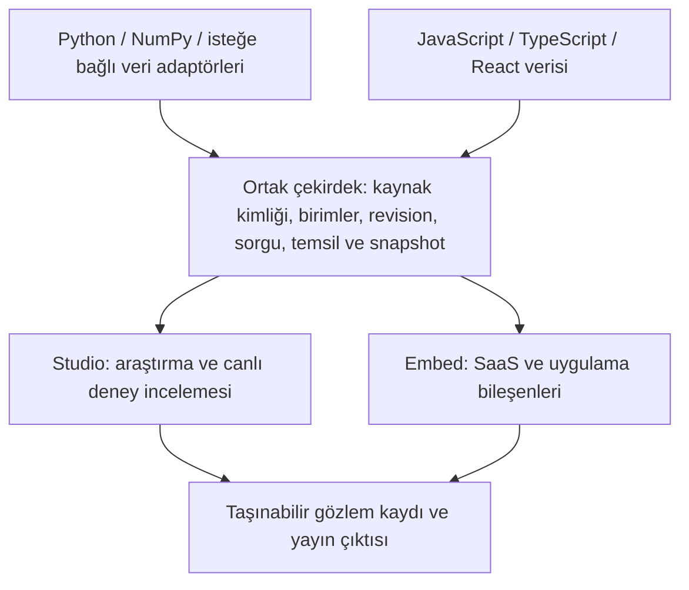

# Vesora: büyük sürüm stratejisi ve araştırma planı

Tarih: 23 Ekim 2026. Durum: karar ve uygulama planı; uygulanmış özellik veya yayın taahhüdü değildir.

Kullanıcının ürün kararı: **araştırmacı/mühendisler ve frontend/SaaS ekipleri eşit öncelikte; ortak motor üzerinde iki ayrı deneyim.**

İnceleme dört çalışma koluyla yapıldı: ürün/entegrasyon ve ticari rakipler, motor/performans, frontend/erişilebilirlik, bilimsel iş akışı/literatür. Kaynak tabanı `029258049818c8aadb6d2a80ca98457522be44c4` ve inceleme anındaki yerel belgeler. Başlangıçta değiştirilmiş README/release/benchmark dosyaları ile yeni ekran görüntüsü vardı; bu plan onları değiştirmez. Rakipler resmî belgelerden araştırıldı; karşılaştırmalı performans çalıştırılmadı.

## 1. Önerilen ürün kararı

**Vesora'nın ana vaadi: büyük ve canlı veriyi akıcı biçimde incelemek; seçilen gözlemi kaynağı, anlamı ve yapılan işlemlerle birlikte Python, notebook, React ve paylaşılmış çıktıda korumak.**

Önerilen büyük sürüm hedefi **Vesora 1.0**, geçici çalışma adı **OBSERVATORY**. `1.0` kararı, aşağıdaki sözleşmelerin kullanıcı deneyleriyle doğrulanıp kararlılık taahhüdü verilebilmesine bağlıdır. Gerekirse ara `0.x` sürümlerle olgunlaştırılır.

İki deneyim:

- **Vesora Studio:** araştırmacının veriyi açtığı, birimlerini gördüğü, yüzey/kesit/cohort karşılaştırdığı, ölçüm notları tuttuğu ve yayın çıktısı hazırladığı çalışma alanı.
- **Vesora Embed:** uygulama ekibinin kendi tasarım sistemi içinde kullandığı, kontrollü React bileşenleri ve arayüzden bağımsız kontrol API'si. Grafik, tablo, inspector ve toolbar aynı gözlem sözleşmesini kullanır.

İki ayrı renderer veya veri doğruluk modeli kurulmaz. Ortak çekirdek görevlerine ek olarak iki deneyimin de kendi kabul testi ve pilot grubu olur.

## 2. Bugün gerçekten ne var?

| Alan | Doğrulanmış mevcut kapsam | Yeni sürümde yeniden icat edilmeyecek temel |
| --- | --- | --- |
| Motor | TypeScript/WebGL2 veri çizimi, Canvas2D metin/eksen; Python binary scene köprüsü; React adaptörü | Aynı renderer ve scene modeli |
| Bilimsel grafik | Line, band, scatter, heatmap, histogram, bar, boxplot; surface, scatter3d, plot3d; karışık 2D/3D paneller | Temel grafik repertuvarı ve gerçek grid satır/sütun kesitleri |
| Canlı veri | Sınırlı retained window, immutable chunks, accepted/rendered ayrımı, freeze sırasında devam eden ingestion | Dondurulmuş gözlemin kaynak kimliği ve yaşam döngüsü |
| İnceleme | Kamera presetleri, equal axes, fit/focus, kaynak farkında picking, inspector | Bilimsel 3D kontrolü |
| Paylaşım | PNG, kaynak veriyi ve runtime'ı içeren offline HTML, displayed-frame export | Etkileşimli dosya ve snapshot sahipliği |
| Frontend | React lifecycle/StrictMode çalışmaları, viewport koruma, tooltip/state özelleştirme, tarih/para formatları, tema | Kullanılabilir bir entegrasyon temeli |
| Araştırma arayüzü | Bookmark, text/hline/vline annotation; Labs'ta iki A/B pin | Basit not, kayıtlı görünüm ve karşılaştırma temelleri |
| Kalite | Arşiv hash'leri, exact-package consumer testleri, gerçek Qt/Jupyter testleri, başarısız RC kayıtları | Tekrar incelenebilir yayın kanıtı |

Kaynaklar: [mimari](../architecture.md), [PRISM sözleşmeleri](../prism.md), [çekirdek tipleri](../../packages/core/src/types.ts), [React kapsamı](../../packages/react/README.md).

Önemli ayrımlar:

- Release paketinin provenance manifesti **araştırmacının veri ve işlem geçmişi manifesti değildir**. `DataDescriptor` bugün id/dtype/shape/version/byteLength taşır; birim ve dönüşüm zinciri taşımaz (`types.ts:56`).
- Offline HTML mevcut retained pencereyi taşır. Diskte tam akış kaydı veya evict edilmiş bütün geçmiş bulunmaz.
- Linked selection bugün genel bir ilişkilendirme sistemi değildir: iki scatter + bir histogram ve açıkça hizalanmış sabit satır kimliği sözleşmesi vardır (`types.ts:116`).
- Çizgi indeksleme ve bazı klavye gezinmeleri zaten vardır. “İlk kez indeks/klavye desteği” doğru bir sürüm anlatısı olmaz.
- Signal Studio'nun command palette, account tablosu ve filtreleri demo uygulama özellikleridir; hepsi ortak viewer API'si değildir.

## 3. Rakipler ve gerçek rekabet alanı

Bu tablo yetenek karşılaştırmasıdır. Bir rakibin belgede anlatmadığı özelliği kesinlikle desteklemediği varsayılmamıştır. Üretici hız iddiaları Vesora ile ölçülmüş kıyas değildir.

| Rakip / grup | Güçlü olduğu doğrulanmış alan | Vesora için çıkarım |
| --- | --- | --- |
| Matplotlib | Geniş bilimsel grafik repertuvarı, hata çubukları, contour/vector field, SVG/PDF | Yayın çıktısı ve bilimsel anlam konusunda temel eksikler kapanmalı. Bütün plot türlerini bir sürümde kopyalamak yerine canlı deneyden web uygulamasına uzanan iş akışı hedeflenmeli. [Grafikler](https://matplotlib.org/stable/plot_types/index.html), [savefig](https://matplotlib.org/stable/api/_as_gen/matplotlib.pyplot.savefig.html) |
| Plotly | Python/JS, bağımsız HTML, SVG/PDF ve 3D isosurface; WebGL katmanlarında hibrit/raster çıktı sınırı | Offline HTML ve 3D tek başına fark değil. Gözlemin canlı alım, inceleme ve çıktı boyunca tutarlı kalması üzerinden kıyas yapılmalı. [HTML](https://plotly.com/python/interactive-html-export/), [çıktılar](https://plotly.com/python/static-image-export/), [isosurface](https://plotly.com/python/reference/isosurface/) |
| Bokeh / HoloViz / Datashader | Bağlı seçimler ve paneller; büyük verinin piksel hücrelerine aggregation'ı | Density ve linked brushing yeni fikirler değil. Genel kaynak kimliği ve browser içinde tekrar açılabilir çalışma akışı geliştirilmeli. [Linking](https://docs.bokeh.org/en/latest/docs/user_guide/interaction/linking.html), [pipeline](https://datashader.org/getting_started/Pipeline.html) |
| SciChart | WebGL/WebAssembly, resampling, FIFO veri, ortak WebGL context ile çok grafik | GPU, bounded buffer ve ortak context tek başına özgünlük değildir. Performans baseline'ı ve uygulama entegrasyonu açısından ciddi rakip. [Performans mimarisi](https://www.scichart.com/documentation/js/v5/2d-charts/performance-tips/performance-tips-and-tricks/), [resampling](https://www.scichart.com/documentation/js/v5/2d-charts/chart-types/data-series-api/resampling/) |
| LightningChart JS | GPU grafikler, DataSet mimarisi, çok iş parçacıklı streaming; v9 duyurusunda 3D DataSet bağlantıları | Canlı ve bilimsel grafik pazarında olgun bir rakip. Üreticinin throughput sayıları aynı koşullarda yeniden ölçülmeden bize karşı hız oranı sayılamaz. [v9 duyurusu](https://lightningchart.com/news/lightningchart-js-v9-0-0/), [resmî dokümantasyon](https://lightningchart.com/js-charts/docs/) |
| VisPy / PyQtGraph | GPU bilimsel grafik, volume/mesh; ROI, image slicing ve downsampling araçları | Masaüstünde gerçek zamanlı bilimsel grafik zaten var. React/browser ile taşınabilir ortak gözlem anlamı daha güçlü odak. [VisPy volume](https://vispy.org/gallery/scene/volume.html), [PyQtGraph](https://www.pyqtgraph.org/), [PlotDataItem](https://pyqtgraph.readthedocs.io/en/latest/api_reference/graphicsItems/plotdataitem.html) |
| ParaView / vtk.js | Mesh/volume, veri pipeline'ı, Python batch, state ve trace | Volume eklemek yetenek genişlemesidir; akademik yenilik değildir. Büyük VTK kapsamı için ileride adaptör yaklaşımı değerlendirilmeli. [vtk.js](https://kitware.github.io/vtk-js/docs/), [state](https://www.paraview.org/paraview-docs/latest/python/paraview.smstate.html), [trace](https://www.paraview.org/paraview-docs/latest/python/paraview.smtrace.html) |
| uPlot / Apache ECharts | uPlot'ta küçük Canvas2D zaman serisi paketi; ECharts'ta ARIA açıklamaları ve desenler | SaaS tarafında paket boyutu, yerleştirme kolaylığı ve erişilebilirlik de kazanma kriteri. GPU varlığı bunları otomatik çözmez. [uPlot](https://github.com/leeoniya/uPlot), [ECharts ARIA](https://echarts.apache.org/handbook/en/best-practices/aria/) |

**Mevcut farkımızın en güçlü adayı**, MIT lisanslı ortak motorda Python/JS/React, bounded streaming, bağımsız frozen observation ve kaynak kimliğini koruyan paylaşımın birlikte sunulmasıdır. Bu bileşimin müşteriye üstün değer verdiği henüz karşılaştırmalı kullanıcı araştırmasıyla kanıtlanmış değildir. MIT ve ortak motor da tek başına benzersizlik değildir.

Bugün savunamayacağımız söylemler: “en hızlı”, “sınırsız veri”, “her cihazda 60 FPS”, “ilk provenance sistemi”, “tüm 3D çıktılar tam vektör”, “Matplotlib/ParaView'ın bütün kullanım alanlarını karşılar”.

## 4. Büyük sürümün dört ana parçası

### A. Taşınabilir, anlamı açık gözlem

Mevcut snapshot'ın üzerine **Observation Capsule** adlı sürümlü bir kayıt sözleşmesi öneriliyor:

- Kaynak dataset kimliği, veri sürümü/hash'i, dtype, boyutlar ve tutulmuş örnek aralığı.
- Stream epoch/sequence, accepted/displayed revision, capture zamanı, selection predicate ve seçili örnek kimliği.
- Alan adı, quantity/unit/dimension, eksik değer politikası ve uncertainty anlamı.
- Kamera/paneller/kesitler, gösterim yöntemi, kaynak örneği/aggregate/interpolasyon ayrımı.
- Kullanılan dönüşümlerin tanımı ve sürümü; varsa runtime/environment referansı.
- Aynı gözleme bağlı notlar, karşılaştırma ve PDF/HTML çıktılarının referansı.

İlk kapsam, taşınabilir sabit gözlemler ve kayıtlı deterministik işlemler olmalı. Keyfî Python callback'leri kendiliğinden tekrar çalıştırılabilir sayılamaz; desteklenmeyen dönüşümler açıkça kayıt altına alınmalı. Uzak kaynağa yalnız referans veren kapsül ile veriyi içinde taşıyan bağımsız kapsül ayrı belirtilmeli. Hash veri bütünlüğünü denetler; deneyin bilimsel olarak doğru yapıldığını kanıtlamaz.

**Kullanıcı deneyimi:** “Bu değer hangi ölçümden geldi, hangi işlemden geçti, şu an ekranda yaklaşık bir temsil mi var?” sorularını tek inspector cevaplar. Aynı gözlem React tooltip, erişilebilir tablo, notebook ve paylaşılmış raporda aynı anlamı taşır.

### B. Akıcı etkileşim ve açık doğruluk sözleşmesi

Önerilen motor hattı:

1. Mevcut line indeksini daha geniş viewport/scale koşullarına taşıyan çok seviyeli özetler.
2. Scatter için spatial tile/hierarchy; her zoom'da bütün kaynağı taramayı azaltan sorgular.
3. Kamera değişiminden bağımsız 3D aday indeksi ve worker/cooperative hazırlama.
4. Büyük yüzey geometrisi hazırlığını ana thread'den çıkarma veya dilimleme; uygun güncellemelerde dirty ranges.
5. Hareket sırasında bütçeli önizleme, durduğunda daha ayrıntılı sonuç; geç gelen sonuçların eski revision'ı göstermesini engelleyen mevcut atomik commit ilkesi.

“Kesinlik” tek bir etiket olmamalı: **özgün kaynak örneği**, **kesin hücre sayımı**, **korunan extrema**, **interpolasyon**, **ölçülmüş/sınırlandırılmış görsel hata** ayrı kavramlardır. Matematiksel bir hata sınırı yalnız kanıtlandığı veri ve çizim koşullarında sunulmalı. “Kesin sonuca dön” bütün noktaların mutlaka tek tek çizilmesi anlamına gelmez; vaat edilen sorgu/temsil sözleşmesinin tamamlanmasıdır.

WebGPU ilk karar olmamalı. Önce sorgu, geometry, upload ve GPU aşamalarının maliyeti ölçülmeli; backend değişiminin hangi darboğazı çözeceği gösterilmeli.

### C. Studio ve Embed için ortak frontend altyapısı

**Studio önerisi:** veri/layer listesi, geniş çizim alanı, bağlama göre açılan inspector; altta sabitlenen gözlemler ve ölçüm notları. Kullanılmayan kamera/export/teknik revision ayrıntıları sürekli aynı ağırlıkta görünmemeli. Yeniden boyutlandırılan paneller, karşılaştırma ve dışa aktarım akışı görev odaklı tasarlanmalı.

**Embed önerisi:** container boyutuna göre düzen; belgeli tema token'ları; toolbar/legend/inspector slotları; controlled selection/viewport; messages/locale; arayüzden bağımsız controller. React'ta mevcut tooltip/state özelleştirmeleri korunup genişletilmeli.

Ortak kesin işler:

- 320/400/640 px gömülü kart ve tam ekran için aynı güvenilir davranış.
- Klavye ile gözlem gezinmesi, veri tablosu, aggregate'den kaynağa açık geçiş; milyon nokta için milyon DOM elemanı oluşturmama.
- “Görünen kare / en son kabul edilen veri” seçimini açıklayan export ekranı; içerilen katman ve retained aralık bilgisi.
- p95 gecikme kadar ilk kullanılabilir görünüm, donmuş görüntünün yaşı, hata/kurtarma ve loading davranışlarının tasarımı.
- 12 ve 24 kartlı dashboard senaryolarında offscreen scheduling ve kaynak yaşam döngüsü ölçümü. Bu sayıların tek Figure mı ayrı Figures mı olduğu testte açık yazılmalı; mevcut ortak context yalnız Figure kapsamındadır.

**Doğrulanmış dar kart problemi:** küçük Chromium/CSS deneyi, 1440 px viewport içinde 320 px viewer'da iç genişliği 318 px, grid'i `88px 230px` olarak verdi. Nedeni sabit sidebar ve viewport media query (`viewer-style.ts:16,39–40`). Bu, grafik çizimi performans testi değil, kaynak CSS için yerleşim probudur. Yeni container testi zorunlu.

### D. Akademik kullanım ve yayın kalitesi

İlk büyük sürüm için:

- **SVG ve PDF:** metin/eksen/uygun 2D geometri vektör; yoğun raster veya 3D katmanlar açıkça belirtilmiş hibrit. mm/inch/DPI, font ve panel etiketleri; tipografik taşma kontrolü.
- **Bilimsel renk:** doğrulanmış palette örnekleri; diverging/centered/log/symlog norm; under/over/bad; ortak color scale. Bugün yalnız beş RGB anchor ile viridis/magma var (`color.ts:3`).
- **Belirsizlik:** x/y ve asimetrik errorbar; mevcut band için confidence/prediction/min-max anlamının açık metadata'sı. Otomatik istatistik çıkarımı ilk kapsama zorunlu değil.
- **Birimler ve matematik metni:** fiziksel boyutların açıklanması, hatalı birim karşılaştırmasının önlenmesi; desteklenen matematik sözdizimi ve export davranışının belirlenmesi.

İkinci fazda **opsiyonel pandas/xarray adaptörleri** öneriliyor: named dimensions, coordinates, masks ve units korunmalı. Arrow/lazy provider çekirdeğe format bağımlılığı yığmadan ayrı modül olarak değerlendirilmeli. İlk büyük sürüm mevcut numeric buffer yolunu kullanabilir; kullanıcı kendi verisinin metadata'sını C1 sözleşmesiyle verir.

Contour/quiver ikinci dalgada güçlü adaydır. Volume, arbitrary plane cuts ve irregular mesh ancak gerçek kullanıcı görevleri bunları önceliklendirirse kapsam büyütmeli.

## 5. “Novel” olabilecek araştırma soruları

Bu bölüm kanıtlanmış özgünlük ilanı değildir. Kapsamlı literatür taraması, doğru baseline ve kontrollü deney gerektirir.

| Hipotez | Olası katkı | Nasıl sınanır? |
| --- | --- | --- |
| H1: Canlı akışta taşınabilir tutarlı gözlem | Bounded ingestion, eviction ve host değişiminde frame/veri/selection'ın yanlış birleşmesini önleyen açık sözleşme | Rastgele append/freeze/evict/reconnect/export dizileri; offline kaynak hash'i, sayısal değer ve cohort üyeliği eşitliği; p95/p99 capture ve peak memory |
| H2: Temsil doğruluğunu açıklayan adaptif ayrıntı | Latency bütçesi altında hangi bilimsel bilginin korunduğunu kullanıcıya ve API'ye bildiren planner | Spike/NaN/log/unsorted/discontinuity fixture'ları; anomaly recall, threshold crossing, görsel hata, refinement süresi; M4/MinMaxLTTB ve uygun Datashader baseline'ları |
| H3: Revision tutarlı, kaynak kimliğini koruyan hızlı linked inspection | Surface/heatmap/slice/tablonun artımlı ve tutarlı sorgulanması | Mevcut projected picking ve scan tabanlı sorguya karşı cold/warm p99, cancellation waste, memory ve kimlik doğruluğu; özellikleri sırayla kapatan ablation deneyleri |

Önceki çalışmalar dikkate alınmalı: [M4](https://www.vldb.org/pvldb/vol7/p797-jugel.pdf) çizgi rasterizasyonuna uygun azaltmayı; [MinMaxLTTB](https://arxiv.org/abs/2305.00332) ölçeklenebilir downsampling'i ele alıyor. [Trrack](https://vdl.sci.utah.edu/publications/2020_visshort_trrack/) web görselleştirmelerinde provenance, paylaşım ve durum geri almayı; [VisTrails](https://www.sci.utah.edu/~stevec/papers/vt-exp.pdf) eylem temelli provenance'ı çalışıyor. ParaView state/trace de mevcut. Bu fikirlerin adlarını değiştirip yeni araştırma olarak sunamayız.

H1 ana ürün hikâyesi, H2 performans ve doğruluk çalışması, H3 altyapı olarak öneriliyor. Host'lar arasında hedef **semantik eşitlik** olmalı; farklı GPU/font sistemlerinde bit düzeyinde aynı piksel çıktısı genel vaat olamaz.

Akademik çıktı paketi: açık benchmark harness'i, lisansı uygun gerçek ve adversarial veri kümeleri, arşivlenmiş ham sonuçlar, ortam/runtime kimlikleri, yöntem belgesi ve sürüm atfı için CITATION.cff. DOI/arşivleme ileride ayrıca yayımlanacak bir işlemdir; bu plan herhangi bir yayın yapmaz. Pilot kullanılabilirlik kanıtıdır; küçük pilot örneklemi tek başına bilimsel üstünlük kanıtı değildir.

## 6. Hız: ölçülen ile hedeflenenin ayrımı

### Mevcut kayıtlı sonuçlar

RC6, kayıtlı Windows/i9-14900HX/Chrome/ANGLE SwiftShader, 1000×600, DPR 1 ortamı; aşağıdaki benchmarklar bu incelemede yeniden çalıştırılmadı. İlk-hazır sonuçları beş eşleştirilmiş koşunun medyanı; interaction sonuçları beş koşunun kendi içindeki p95 değerlerinin medyanıdır.

| Metrik | Kayıtlı sonuç |
| --- | ---: |
| 1M satır line ilk hazır | 166,9 ms |
| Line interaction p95 | 177,0 ms |
| 1M satır density ilk hazır | 182,5 ms |
| Density interaction p95 | 247,9 ms |
| 60 sn, üç retained seri browser streaming p95 | 125,2 ms |
| Kurulu Qt / Jupyter örneği p95 | 48,74 / 189,61 ms |

Kaynak: [RC6 benchmark raporu](../benchmarks/v0.9.0.md). 2D süreler `Figure.ready()` tamamlanmasını ölçer; fiziksel ekrana varış veya FPS değildir (`benchmark-v09.mjs:95`). Tarihsel 3D matrisi `gl.finish()` kullanır; 500K scatter cold pick 228,6 ms, warm pick p95 3,2 ms ve orbit p95 250,5 ms farklı build'e aittir. Bu tabloya RC6 ölçümü olarak eklenmemelidir.

### Koddan doğrulanan maliyet noktaları

| Kaynak | Bulgu | Öneri |
| --- | --- | --- |
| `planning.ts:58,89` | Scatter viewport sorgusunda tam tarama; sparse modda ikinci tarama | Spatial hierarchy ve incremental query |
| `planning.ts:159`; `line-index.ts:149` | Sıralı line aralık daraltması zaten var; hızlı indeks yolu sınırlı koşullara bağlı | Mevcut indeksin kapsamını genişletme |
| `picking3d.ts:34` | Kamera/viewport değişince projected index'in senkron yenilenmesi | Object-space aday indeksi ve async/cooperative hazırlama |
| `view.ts:491`; `geometry.ts:158` | Geometry/surface hazırlığında senkron döngüler | Worker/cooperative geometri hattı |
| `renderer.ts:121` | Kısmi upload öncesi ortak baş/son bulmak için dizilerin taranması | Mutasyonlardan dirty-range bilgisi |

Bu bulgular profiler ile toplam sürenin yüzde kaçını aldıkları kanıtlanmış kök nedenler değildir. İlk teknik spike aşama sürelerini ölçmelidir.

### Önerilen performans kabul hedefleri

| Hedef | Ölçüm kapsamı |
| --- | --- |
| Etkileşim önizlemesi p95 ≤33 ms; vaat edilen son temsile yerleşme p95 ≤100 ms | Girdi olayından committed preview'a; son etkileşim olayından son temsil commit'ine. Seçilecek referans iGPU ve ayrı GPU cihazlarında 1M 2D sabit iş yükü; DPR, panel sayısı, dağılım ve yöntem sabit |
| Cold picking p95 ≤50 ms; warm hover p95 ≤16 ms | Tanımlı 500K 3D scatter, kamera değişiminden sonra cold/warm ayrı |
| 30 dk streaming p95 ≤50 ms, p99 ≤100 ms | Mevcut belgelerdeki optimizasyon hedefi. Producer append çağrısından ilgili revision'ı kapsayan rendered acknowledgement'a; cadence, retained rows ve host sabitlenmeli |
| Worker transfer byte'larında ≥%80 azalma | Aynı sabit baseline ve aynı ingestion/export/freeze iş yükü; kopyaların bellek etkisi ayrıca |
| 2 saat kesintisiz browser/Qt/Jupyter | Kabul edilen sequence'ların tam muhasebesi, drain, cleanup ve freeze/export doğruluğu |
| Dashboard ve paket bütçeleri | İlk spike'ta 12/24 chart senaryosu, cold start, import/export ayrımı ve gerçek consumer bundle ölçülüp eşikler dondurulur |

Bunlar **tasarım hedefidir**, ölçülmüş başarı veya cihazdan bağımsız taahhüt değildir. Commit/ack metrikleri GPU completion veya fiziksel ekrana varış değildir; GPU completion ve uygun input-to-visible ölçümü ayrı raporlanmalı. SwiftShader ayrı uyumluluk/performance sınıfında raporlanmalı. Bellek ölçümleri source/cache/worker/geometry/picking/heap/process kapsamlarını ayırmalı; mevcut sayaçlar toplam GPU/süreç belleği değildir.

### İnceleme sırasında yapılan ek paket probu

Mevcut yerel `dist` dosyalarına esbuild `bundle + minify`, ESM, ES2022 ve gzip uygulanarak bellekte keşif ölçümü yapıldı; paketler yeniden build edilmedi. Özel dosya çözümleyici kullanıldı; bu ölçüm gerçek Vite/Next ağ yüklemesi veya standart resolver/tree-shaking garantisi değildir.

| Tüketim | Minified byte | Gzip byte |
| --- | ---: | ---: |
| `figure` kullanımı | 213.901 | 66.969 |
| `figure + toHTML` kullanımı | 746.583 | 194.725 |
| `figure + mountViewer` kullanımı | 763.777 | 200.760 |

Örnek girişler sırasıyla `globalThis.chart=figure()`, `globalThis.exportFigure=()=>toHTML(figure())` ve `globalThis.viewer=mountViewer(figure(),document.getElementById('chart'))`. İlk iki import yerel core `dist/index.js`, viewer import'u `dist/viewer.js` üzerinden yapıldı. Node v24.19.0; worker ağ indirmesi/runtime kaynak kullanımı bu byte'lara ek ölçülmedi.

Yerel core runtime SHA-256: `787d7f638efdf92f39119dd8bb039d6e78275163c83f01ccc575910238ad0c96`; viewer: `efbed37789ede0505e30d195f20eaf91454cb695b7be4cd0543af949d9b8ae55`.

`scripts/build.mjs:17–26` standalone runtime'ı HTML exporter içine gömüyor. Bu nedenle export kodunu gerektiğinde yüklemek ve minimal embed yolunu ayrı ölçmek anlamlı bir fırsat. Offline dosyanın kendi kendine yeterliliği korunmalı; bunun uygulama ilk yüklemesinde ne kadar kazanç sağladığı ayrı consumer deneyiyle doğrulanmalı.

## 7. Uygulanabilir release backlog'u

P0: mevcut yayın kabul borcu. P1: önerilen büyük sürümün zorunlu kapsamı. P2: beta geri bildirimine göre genişleme. “L/XL” göreli belirsizlik ve kapsamdır; süre tahmini değildir.

| ID | Öncelik / kapsam | Somut teslim | Kabul kanıtı | Bağımlılık |
| --- | --- | --- | --- | --- |
| R0 | P0 / mevcut RC | Kesintisiz soak, gerçek screen-reader, 5 kişilik mevcut pilot; belge durumlarının uzlaştırılması | Sabit arşivle 10 gate tamam; final sürüm kimliği değişirse yeniden doğrulama | Mevcut exact RC arşivleri |
| C1 | P1 / L | Sürümlü observation/semantics şeması; units, source/transform/representation metadata | JS/Python/import-export fixture'ları; yanlış/missing referansları açık reddetme; eski protokoller | R0 ile paralel tasarlanabilir |
| E1 | P1 / XL | Indexed 2D sorgu ve cold 3D pick; incremental hazırlama | Sabit correctness oracle, cold/warm ölçüm, bellek/iptal testleri ve performance hedefleri | Profiling; C1 temsil sözleşmesi |
| U1 | P1 / L | Container-aware layout, tokens/slots/controller, locale | Büyük sayfada dar kart testleri; app-owned tasarım; odak/lifecycle/StrictMode | C1 event anlamları; E1 ile paralel |
| S1 | P1 / L | Renk normları, units, errorbar, uncertainty metadata ve temel matematik etiketleri | Negatif/pozitif/NaN/log fixture; yanlış birim kıyasları; JS/Python eş anlamlılık | C1 |
| O1 | P1 / XL | Portable observation capsule; not/karşılaştırma ve export inspector; SVG/PDF hibrit yol | Offline aynı sample/cohort/değer; font/ölçü/layout QA; çıktı türü ve kapsamı açık | C1 + S1 + U1 |
| A1 | P1 / L | Erişilebilir veri inceleme ve tablo; klavye coverage | Gerçek NVDA/Narrator görevleri, zoom/container/reduced-motion; aggregate anlamı doğru | U1 + C1 |
| D1 | P1 / M–L | İki ayrı onboarding yolu, paket bütçesi, örnekler, migration ve hata rehberi | Araştırmacı kendi verisini açar; frontend ekibi kendi uygulamasına entegre eder; temiz consumer kurulumları | U1 + O1; test matrisi |
| L1 | P2 / XL | Genel linked observations ve named cohorts; tablo/heatmap/line/3D bağlantıları | Explicit IDs/alignment; stale cohort yok; frozen/live tutarlılığı | C1 + E1 |
| AD1 | P2 / L–XL | pandas/xarray adaptörleri; Arrow/lazy provider prototipi; contour/quiver | Semantik/mask/koordinat korunumu, iptal ve bounded memory; gerçek kullanım görevi | C1 + E1 + S1 |
| R1 | P2 / XL | Disk kayıt/history provider ve zaman içinde yeniden oynatma | Quota, eksik geçmişin açıklanması, restart/recovery ve sequence doğruluğu | C1 + O1; ayrı veri sağlayıcı tasarımı |

Önce yapılacak teknik deneyler: cold picking; scatter hierarchy; tam semantik kapsül; hibrit SVG/PDF layout. Bu dört deneyin maliyeti ve elde edilen kazanç görülmeden bütün P2 kapsamına tarih verilmemeli.

## 8. Milestone ve yayın kapıları

1. **M0 — Güvenilir taban.** Mevcut RC kabul işleri kapatılır. İlk incelemede `v1-readiness.md` ve `architecture.md` içinde saptanan eski durum/indeks/context restore açıklamaları uygulamaya başlarken güncellendi. RC6'nın yedi geçmiş kapısına ek olarak kesintisiz soak ve gerçek insan kanıtlarının tamamlanması gerekir.
2. **M1 — İki kullanıcının aynı gözlemi paylaşması.** C1 şeması, units/representation sözleşmesi ve U1 entegrasyon prototipi. Bir araştırmacı notebook'ta kaydı açar, frontend örneği aynı gözlemi uygulama arayüzünde gösterir. Semantik eşitlik doğrulanır.
3. **M2 — Hız ve bilimsel anlam.** E1 ve S1; temsilde neyin korunduğu görünür. Aşama süreleri, cold/warm ölçümleri ve adversarial veri yayın raporuna hazırlanır.
4. **M3 — Çalışma alanından rapora.** O1, A1, D1; Studio ve Embed task flow'ları tamamlanır. PDF/SVG/HTML aynı gözlem kaydına bağlanır. İki grubun görevleri eşit ağırlıkla pilot edilir.
5. **M4 — Beta ve 1.0 kararı.** Önerilen yeni beta: en az 5 araştırmacı/mühendis ve 5 frontend geliştirici; her grupta en az 4 kişi kendi ana görevini yardım almadan tamamlamalı. Kritik yanlış gözlem/yanlış değer aktarımı kabul edilmez. Bu küçük pilot kullanılabilirlik içindir; üstünlük çalışmasının örneklem tasarımı ayrıca yapılır.
6. **M5 — Sabit arşiv yayını.** Yeni release kimliği, paket/host/uyumluluk/performance/soak kanıtı ve migration kontrolü. Yayın sonrası indirilen exact sürümler ayrıca doğrulanır.

Mevcut RC pilotu 5 kişi ve en az 4 yardımsız başarıdır; önerilen yeni iki gruplu beta bunun yerine geçmez. İnsan katılımcı ve gerçek screen-reader sonuçları otomatik testten üretilemez.

Takım kapasitesi bilinmediği için kesin tarih verilmedi. İlk 1–2 haftalık keşif/spike kapasitesi planlanıp M1 sonunda efor ve sıra yeniden tahmin edilmeli. Core/performance, frontend/UX, bilimsel semantics/export ve QA/pilot ayrı sorumluluk hatlarıdır; aynı ortak sözleşmeler üzerinde paralel çalışırlar.

## 9. İlk büyük sürüme yığılmaması gereken işler

- Baştan sona WebGPU rewrite: önce ölçülmüş ihtiyaç ve fallback planı.
- Volume, arbitrary mesh, arbitrary cutting plane ve tam VTK alternatifi: kullanım kanıtına göre modüler genişleme.
- Genel amaçlı AI sohbeti: ana inceleme akışının faydası kanıtlandıktan sonra, kaynak gösteren komut üretimi gibi dar bir iş düşünülmeli.
- Cloud collaboration/account/billing: mevcut library ve local/offline avantajının önüne ürün altyapısı yüklememeli.
- Çok sayıda süs grafik: önce bilimsel anlam, gömme deneyimi ve gerçek görevleri tamamlama.

## 10. Lansmanda gösterilecek tek uçtan uca senaryo

Bir mühendis canlı deneyin kararlı API'lerle desteklenen akışında bir kaynak örneğini seçer; veri gelmeye devam ederken gözlem sabitlenir. Aynı çalışma alanında deneyin regular-grid yüzeyinden bir hücre ve ona bağlı gerçek satır/sütun kesiti incelenir. İki görünüm aynı deney kaydına açık kaynak kimlikleriyle bağlanır; genel 3D bölge/cohort seçimi bu ilk senaryoda gerekmez. Quantity/unit, kullanılan dönüşüm ve temsil durumu görünür. Kullanıcı gözleme not ekler, önceki kayıtla karşılaştırır ve aynı kayıttan yayın boyutunda PDF ile etkileşimli HTML üretir. Frontend geliştiricisi bu kaydı kendi uygulamasında, kendi toolbar ve inspector tasarımıyla açar. Her ortam aynı kaynak kimliğini, değerleri ve açıklanmış yöntemleri doğrular.

Bu senaryonun freeze/slice/offline parçaları bugün var. Yeni sürümün farkı, bunlara **semantik ve işlem geçmişi, açık temsil doğruluğu, akıcı büyük veri sorguları, yayına uygun çıktı ve uygulamaya uyarlanabilir arayüz** eklenmesidir. Başarı; özellik sayısıyla birlikte değil, bu görevin doğruluğu, süresi ve kullanıcı tarafından yardım almadan tamamlanmasıyla ölçülmelidir.

## İncelemenin sınırları

- Ürün kodu değiştirilmedi; kapsam keşif, plan, kaynak/CSS/bundle problarıydı.
- Tam test/benchmark suite'leri yeniden çalıştırılmadı. Kayıtlı RC sonuçları ilgili arşiv/build kapsamıyla aktarıldı.
- Rakipler aynı makinede kurulup ölçülmedi. Rekabet tablosu birinci taraf yetenek belgelerine dayanıyor; önerilen üstünlükler test edilecek hipotezlerdir.
- İlk literatür taraması yapıldı; sistematik novelty taraması veya akademik kabul iddiası yok.
- Mevcut durumun otoriter kayıtları: [RC6 checklist](../releases/v0.9.0.md), [benchmark raporu](../benchmarks/v0.9.0.md), yerel `dist/release-v0.9.0-rc.6/release-gates.json`. Son kayıtta 7 passed, soak failed, accessibility ve betaPilot pending.
